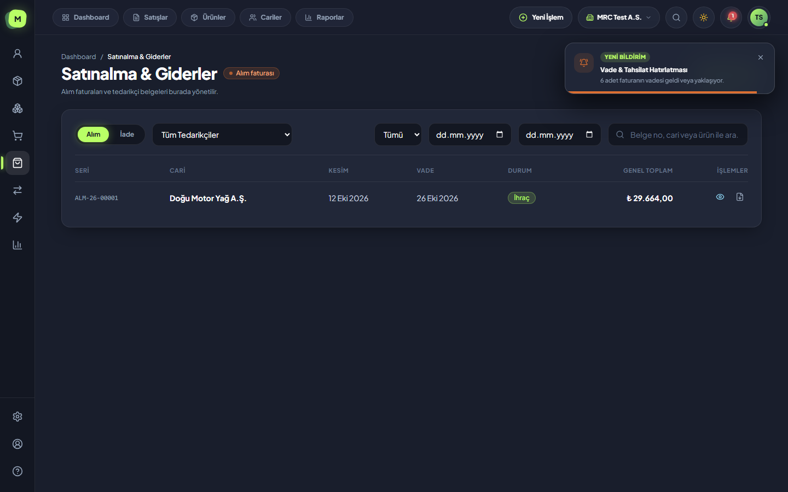

# Alımlar (Satınalma & Giderler)

## Bu ekran ne işe yarar?

Nereden, ne fiyata aldığını buradan belgelersin. **Alım faturası** kesildiğinde (belge **İhraç**
edildiğinde) iki şey kendiliğinden olur: mal **seçtiğin depoya girer** ve ürünün **ağırlıklı
ortalama maliyeti** güncellenir. Bu yüzden satış kârın doğru hesaplanır.

Ekranın başlığında turuncu rozet **Alım faturası** yazar; altta „Alım faturaları ve tedarikçi
belgeleri burada yönetilir." açıklaması vardır.

## Adım adım

### 1) Alım belgelerini listeleme

1. Sol menüden **Alım** seçeneğine tıkla (üst menüde **Alımlar**).
2. Üstteki sekmelerle tipi seç: **Alım** · **İade** (tedarikçiye gönderdiğin mallar).
3. Filtreler: **Tüm Tedarikçiler** (tek tedarikçiye inebilirsin), durum
   (**Taslak / İhraç / İptal**), **Başlangıç** ve **Bitiş** tarihleri, arama kutusu
   („Belge no, cari veya ürün ile ara...").
4. Tablo: **SERİ · CARİ · KESİM · VADE · DURUM · GENEL TOPLAM · İŞLEMLER**. Numara biçimi
   `ALM-26-00001` (iade: `IAD-…`).
5. Tedarikçiye mal iadesi: kesilmiş alımın detayında **İade al** → satırlar taşınır,
   miktar budanabilir → **İhraç et** (stok düşer). Detay [Satislar](Satislar) §9'daki
   akışın aynısıdır, yönü terstir.

### 2) Alım faturası kesme

1. Sağ üstteki **Yeni Belge** butonuna bas.
2. **Tedarikçi \*** alanına tedarikçinin adını yaz ve açılan listeden **seç** (cari tipinde
   **Tedarikçi** veya **Her İkisi** olmalı).
3. **Depo** kutusundan malın gireceği depoyu seç. Depo seçmezsen firmanın **varsayılan deposu**
   kullanılır.
4. Satırı kur: **ürün seç** (ad, birim, fiyat ve KDV otomatik gelir) veya serbest kalem adı yaz
   (hizmet, kira, nakliye gibi).
5. **Miktar**, **Birim Fiyat** (bu alımda ödediğin birim fiyat), **İskonto %**, **KDV %** gir.
6. Alt toplamları kontrol et: **Ara toplam · İskonto · KDV · Genel toplam**.
7. **Notlar** alanına irsaliye/fatura gibi referans yazabilirsin.
8. **Kaydet** → belge **Taslak** olarak açılır.
9. **İhraç et** butonuna bas → stok girer, ortalama maliyet güncellenir.

> Ekranın uyarısı: „Stok takibi açık olan ürünler, belge İhraç edildiğinde seçili depoya giriş
> yapar ve ağırlıklı ortalama maliyeti günceller."

### 3) Hizmet ve gider kalemleri

Ürün seçmeden **serbest satır** yazarsan (ör. „Nakliye", „Kira") stok etkisi olmaz; tutar
gider/alım toplamına girer. Bu satırların **maliyeti yoktur**; kâr raporunda „maliyeti eksik
satır" olarak sayılır.

### 4) Taslak belgede düzenleme, silme, PDF

- **Düzenle** ve **Sil** yalnız **Taslak** belgelerde görünür; silmede „**Belge Silinsin mi?** —
  Bu işlem geri alınamaz. **ALM-26-00001** kalıcı olarak silinecektir." onayı çıkar
  → **Evet, Sil** / **Vazgeç**.
- **PDF indir** → `ALM-26-00001.pdf`. Taslakta „TASLAK" filigranı taşır.

## Alan açıklamaları

| Alan | Zorunlu | Boş bırakılırsa | Not |
| --- | --- | --- | --- |
| Tedarikçi | Evet | Kaydedilmez | Cari tipi **Tedarikçi/Her İkisi** olmalı |
| Depo | Hayır | **varsayılan depo** | İhraçta mal buraya girer |
| Kesim / Vade | Hayır | bugün / vadesiz | Vade, borç yaşlandırma raporunu belirler |
| Para Birimi | Hayır | firmanın para birimi | Ödeme aynı para birimiyle yapılabilir |
| Ürün | Hayır | serbest satır | Ürün seçilirse stok + maliyet etkisi vardır |
| Miktar | Evet | 0 olamaz | Ondalık olabilir (1,5 kg gibi) |
| Birim Fiyat | Evet | 0 | **Alım fiyatın**; ortalama maliyeti bundan hesaplanır |
| İskonto % / KDV % | Hayır | 0 / ürünün oranı | Satır bazında değiştirilebilir |

## Takıldığınızda

- **„Cari hesap alanı zorunludur."** → Tedarikçiyi yazıp açılan listeden seçmedin.
- **„Bu cari hesap tipi için bu yönde ödeme kaydedilemez."** → Cari **Müşteri** olarak tanımlı;
  ondan mal alıyorsan tipini **Her İkisi** yap.
- **„Yalnızca taslak belgeler düzenlenebilir." / „…silinebilir."** → Belge ihraç edildi; düzeltmek
  için yeni alım faturası kes (fiyat farkı veya iade yerine sonraki alımda iskonto).
- **„Bu belge `draft` durumundan `issued` durumuna geçirilemez." gibi bir uyarı** → Belgede satır
  yoksa veya veri eksikse önce satırları tamamla.
- **Alım sonrası ürünün alış fiyatı değişmedi** → Ürün **stok takibi kapalı** olabilir; ürün
  kartında **Stok takibi açık** anahtarını denetle.
- **Stok değeri raporunda mal görünmüyor** → Belge henüz **Taslak**; **İhraç et**.

## Bilmenizde yarar var

- Ortalama maliyet formülü: (eski stok × eski maliyet + gelen miktar × alım birim fiyatı) ÷ yeni
  toplam stok. Bu yüzden **pahalı alım maliyeti yükseltir, ucuz alım düşürür**.
- Alım faturası **borcunu** artırır; ödemeyi **Borç-Alacak** ekranından kaydedersin. Belge
  ödendikçe durumu kendiliğinden **Kısmen ödendi → Ödendi** olur.
- Maliyeti dondurulan şey **satış** satırıdır: satış faturası kesildiği andaki ortalama maliyet
  satıra yazılır ve sonradan değişmez.
- Aynı tedarikçiden tekrar alım yapsan bile eski satışların kârı etkilenmez.
