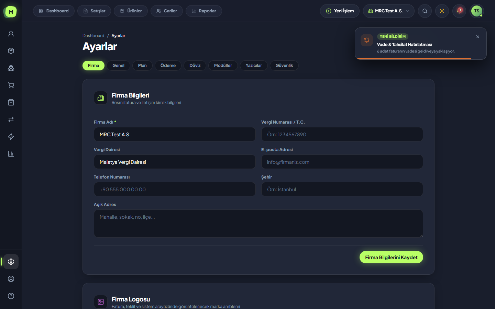

# Ayarlar

## Bu ekran ne işe yarar?

Firmanın kimliğini (ad, vergi no, adres), iş kurallarını (para birimi, varsayılan KDV, vade,
fatura seri öneki) ve arayüz dilini buradan yönetirsin. Faturalarda ve raporlarda görünen
bilgiler buradan gelir.

Ekran sekmelidir: **Firma** (bilgiler + logo) · **Genel** (ayarlar + dil) · **Plan**
· **Ödeme** (PayTR/iyzico) · **Döviz** (para birimleri + kurlar) · **Modüller**
(modül/eklenti açma-kapama) · **Yazıcılar** (köprü cihazları + kuyruk) · **Güvenlik**
(iki faktör + erişim anahtarları). Kartların düzeni aşağıda anlatılır.

## Adım adım

### 1) Firma bilgileri

1. Sol menüden **Ayar** → **Sistem Ayarları** ekranını aç.
2. **Firma Bilgileri** kartı („Resmi fatura ve iletişim kimlik bilgileri").
3. Doldur: **Firma Adı \***, **Vergi Numarası / T.C.**, **Vergi Dairesi**, **E-posta Adresi**,
   **Telefon Numarası**, **Şehir**, **Açık Adres**.
4. **Firma Bilgilerini Kaydet** butonuna bas. Üst menüdeki firma adı da güncellenir.

> **Vergi Dairesi** ve **Vergi Numarası / T.C.**, belge PDF’inin üstündeki firma künyesinde
> basılır („Vergi dairesi: …”, „Vergi no: …”). Boş bırakırsan o satır PDF’te hiç çıkmaz.

### 2) Genel ayarlar

1. Aynı sayfada **Genel Ayarlar** kartı („Para birimi, varsayılan KDV oranı ve faturalama
   parametreleri").
2. **Para Birimi (currency_code)**: **₺ Türk Lirası (TRY)** / **US Dollar (USD)** / **€ Euro (EUR)**.
3. **Varsayılan KDV Oranı (%)**: ürün kartı ve belge satırı için başlangıç oranı.
4. **Fatura Seri Öneki**: fatura numarasının başına düşen ifade (örn. „FT").
5. **Varsayılan Vade (Gün, 0-365)**: yeni belgelerin vadesi kesim tarihine bu gün eklenerek bulunur.
6. **Genel Ayarları Kaydet**.

### 3) Firma logosu

1. **Firma Logosu** kartı („Fatura, teklif ve sistem arayüzünde görüntülenecek marka amblemi").
2. **Yeni Logo Seç (PNG, JPG, WebP — Maks 2 MB)** → dosyayı seç.
3. **Logoyu Yükle**. Yanlış seçim için **Seçimi Temizle**.

> Yüklediğin logo, **belge PDF’lerinde** (teklif/sipariş/fatura/alım) firma adının üstünde
> basılır. Logo en fazla **48 px yükseklikte** basılır; çok geniş dosyalar otomatik küçülür.
> Logo dosyası sunucuda kaybolursa belge yine üretilir, yalnız logo satırı düşer.

### 4) Dil değiştirme

1. **Dil / Language** kartı („Arayüz dilini seçin").
2. **Türkçe** veya **English** butonuna bas.
3. Tercih anında uygulanır: başlıklar, butonlar, menü, tarih-sayı biçimi ve sonraki hata mesajları
   seçtiğin dilde çıkar. Sayfayı yenilemene gerek yoktur.
4. Tercih **hesabına kaydedilir**: başka cihazdan girsen veya çıkıp girsen aynı dil devam eder.

### 5) API erişim anahtarları (masaüstü uygulama / entegrasyon)

1. **API Erişim Anahtarları** kartını bul („Masaüstü uygulaması ve entegrasyonlar bu
   anahtarlarla bağlanır. Anahtar yalnız üretildiği an gösterilir.").
2. **Anahtar adı** yaz (örn. `Masaüstü kasa`, `Rapor robotu`) ve **Yetki** seç:
   **Tam yetki** (her şey), **Salt okuma** (yalnız görüntüleme), **Yazma yetkisi**.
3. **Anahtar üret** → yeşil kutuda anahtar görünür: „**Anahtar hazır — bir daha
   gösterilmeyecek.**" **Kopyala** ile panoya al ve masaüstü uygulamasındaki giriş
   alanına yapıştır. Kutuyu kapattıktan sonra anahtar **bir daha gösterilmez**.
4. Listede her anahtarın yanında yetkisi yazar (**Tam yetki / Salt okuma / Yazma yetkisi**),
   altında „Oluşturulma: … · Son kullanım: … (veya „Hiç kullanılmadı") · Geçerlilik: …".
   Giriş ekranının kendi oluşturduğu satırlar **Giriş oturumu / Tarayıcı oturumu**
   olarak işaretlenir; şu anda kullandığın satır **Şu anki oturum** rozeti taşır ve
   iptal edilemez (kendi oturumunu kapatmamak için).
5. Bir anahtarı kapatmak için satırındaki **İptal et** → **Evet, iptal et**. Anahtar
   o andan itibaren reddedilir (`401`). Süresi dolan anahtar kendiliğinden düşer
   (erişim anahtarları varsayılan **90 gün**, tarayıcı oturumları **14 gün**).

> Anahtarını kaybeden ya da ele geçirdiğinden şüphelendiğin kişi için: eski anahtarı
> **İptal et**, yenisini üret. Sistem anahtarın şifresini saklamaz; bu yüzden „şifremi
> unuttum" diye geri verilmez.

### 6) Plan ve Limitler

**Plan ve Limitler** kartı şunu söyler: hangi plandasın ve o planın izin verdiği sayılara
ne kadar yaklaştın. Kart salt okurdur — **Personel** de bakabilir, çünkü „neden yeni kayıt
alamıyorum" sorusunun cevabı buradadır.

| Satır | Ne sayılır |
| --- | --- |
| **Kullanıcı** | Firma üyeleri + **kabul bekleyen davetler**. Davet göndermek de hak tüketir. |
| **Ürün** | Silinmemiş ürün/hizmet kartı toplamı. |
| **Aylık belge** | O **takvim ayında oluşturulan** belgeler (teklif, sipariş, fatura, alım). |
| **Aylık ödeme linki** | O ay içinde üretilen ödeme linkleri. |

- Sayının yanında **kaç / kaç** ve altta **kaç hak kaldı** yazar. Bar turuncuya dönerse
  (%80+) limite yaklaştın, kırmızıysa dolmuştur.
- Limit dolunca kayıt **oluşmaz** ve ekranda çevrilmiş bir uyarı görürsün
  (örn. „**Bu ayki belge limitine ulaştınız (2/2).**"). Nedeni ve çözüm yolları:
  [HATA-MESAJLARI](HATA-MESAJLARI).
- **Dönüştürme de yeni belgedir:** teklifi siparişe, siparişi faturaya çevirmek aylık belge
  sayacını 1 artırır. Belgeleri **güncellemek** sayacı artırmaz.
- Sayaçlar **ayın ilk günü** sıfırlanır. Plan değişikliği bu ekrandan yapılmaz; hesabın
  sahibi/Yetkili Satıcı üzerinden yapılır — kartın altında bu yazar.

### 7) Ödeme Ayarları (PayTR / iyzico ile kartla tahsilat)

**Ödeme Ayarları** kartı yalnız **yöneticiye (Admin)** görünür — Personel bu bölümü
göremez (hesap anahtarları para kasasının anahtarıdır). İki sağlayıcı yan yana durur:
**PayTR** ve **iyzico**. İkisini birden tanımlayabilirsin; bağlantı üretirken hangisini
kullanacağını her faturada ayrı seçersin.

1. Kullanacağın sağlayıcının alanlarını doldur:
   - **PayTR:** **Mağaza numarası**, **Mağaza anahtarı**, **Güvenlik parolası (salt)**
     (üçü de PayTR mağaza panelinin BİLGİ sayfasındadır).
   - **iyzico:** **API anahtarı**, **Gizli anahtar** (iyzico panelinden alınır).
2. **Tahsilat hesabı** seç (örn. bankadaki cari hesap): sanal POS'tan gelen para defterde
   bu hesaba işlenir. Seçmezsen tahsilat yine kaydedilir ama **Kasa/Banka** ekranında
   bir hesaba bağlı görünmez. Para birimi ödemeyle aynı olmalı, değilse hesap bağlanmaz.
3. **Deneme modu** işaretliyse gerçek para alınmaz (PayTR'da ayrı deneme sunucusu yoktur;
   deneme aynı adresten „test modu" işaretiyle yapılır). Canlıya geçerken işareti kaldır.
4. **Hesap etkin** işaretle → **Kaydet**. Eksik alanla etkinleştirmeye çalışırsan sistem
   hangi alanı dolduracağını söyler.
5. Karttaki **bildirim adresini kopyala**: PayTR mağaza panelindeki **Bildirim URL**
   alanına aynen yapıştır (sonuçlar bu adrese gelir). Adres tüm firmalar için ortaktır;
   hangi firmanın işlemi olduğu bağlantı numarasından bulunur, senin bir şey yapman gerekmez.
6. Anahtarları değiştirmek için üzerine yaz; **korumak için boş bırak** (boş alan mevcut
   değeri silmez). Hesabı tümüyle kaldırmak için **Hesabı kaldır** → **Evet, kaldır**.
7. Müşteriye bağlantı gönderme: [Satislar](Satislar) §8. Sürecin tamamı: [ONLINE-ODEME](ONLINE-ODEME).

### 8) Para Birimleri ve Kurlar

**Para Birimleri ve Kurlar** kartında 4 para görünür: **TRY** (ana para, hep açık),
**USD**, **EUR**, **GBP**. Her satırda bugünkü kur yazar (örn. „1 USD = 49,7747 TRY ·
2026-10-31 · tcmb").

- Kurlar **her sabah otomatik** çekilir (önce TCMB, düşerse yedek kaynak). Elle kur
  girilmez; „dünkü kurla keseyim" diye bir şey yoktur.
- Dövizli belge (USD/EUR/GBP) kesilirken o günün kuru belgeye **işlenir** ve bir daha
  değişmez: kur yarın artsa da fatura aynı kurla kalır (muhasebe fotoğrafı).
- Kullanmadığın dövizi **Kapat** ile pasif yapabilirsin — pasif parayla **yeni belge
  kesilemez**. **TRY kapatılamaz** (sistem buna izin vermez).
- Kartı herkes görür; açma/kapama yalnız **Admin** yapar.

### 9) Modüller ve Eklentiler

**Modüller ve Eklentiler** kartında firmanın özellikleri listelenir: **Panel** (kapatılamaz),
**Cariler, Ürünler, Stok, Belgeler** (Satışlar + Alımlar), **Borç-Alacak, Raporlar,
Online Tahsilat, Döviz, Ekip**. Eklentiler (örn. **Yazı Notları**) aynı listede
**Eklenti** rozetiyle görünür.

1. **Eklentileri Tara** → `plugins/` klasöründeki eklenti bildirimleri okunur;
   kurulmamış eklenti **Kurulu değil** rozetiyle listeye düşer.
2. Kurulu değilse **Kur** → eklenti firmana kurulur ve açılır. Kurulan eklentinin
   pano aracı (örn. **Hızlı Not**) panele düşer.
3. Kullanmadığın modülü **Kapat** ile pasif yap: menüdeki simgesi gizlenir, pano
   aracı kaybolur, ilgili ekranın adresi **„Bu modül kapalı."** der.
4. **Kapatılan modülün kayıtları silinmez**: yeniden **Aç** dediğinde her şey
   bıraktığın gibidir (stok, belge, rapor aynen durur).
5. **Eklenti ayarını düzenle** bağlantısı (ayar şeması olan eklentilerde) eklentinin
   metnini değiştirir — örn. Hızlı Not'un panoda gösterdiği yazı.

> Kartı herkes görür; açma/kapama/kurulum yalnız **Admin** yapar. Personel düğmeye
> basarsa „Bu işlem için yönetici yetkisi gereklidir." çıkar.

### 10) Yazıcılar (köprü cihazları + kuyruk)

**Yazıcılar** sekmesinde firmanın PC'lerindeki köprü uygulamaları ve yazdırma kuyruğu
durur. Liste herkese açıktır (POS'tan fiş göndermek için cihaz/yazıcı seçimi gerekir);
**cihaz ekleme/silme yalnız Admin** yapar.

1. **Yeni cihaz eşleştir** → **Cihaz adı** yaz (örn. `Kasa PC`) → **Kod üret**.
   Ekranda `XXXX-XXXX` biçiminde kod belirir — **tek kullanımlık, 15 dakika geçerli**.
2. Köprü uygulamasında bu kodu gir: uygulama yazıcı listesini bildirir ve cihaz
   anahtarı alır. Cihaz satırında yazıcılar görünür, nabız yeşile döner
   (**Çevrimiçi** = son 2 dakikada nabız alınmış).
3. POS'ta satış tamamlanınca **Köprü yazıcısı** listesinden `Cihaz → Yazıcı` seç →
   **Yazıcıya gönder**. Fiş 32 sütun termal fiş olarak kuyruğa düşer (para üstü varsa
   fişte basılır).
4. Kuyrukta her işin durumu görünür: **Kuyrukta / Yazdırılıyor / Başarısız**.
   Başarısız iş 5 denemeden sonra terminal olur ve 24 saatte silinir; o arada belge
   durur — yeniden kuyruğa alabilirsin ya da mobil PDF'e düşersin.
5. Kullanmadığın cihazı **Kaldır** → **Evet, Sil** (cihaz + kuyruğundaki işleri düşer).

## Alan açıklamaları

| Alan | Zorunlu | Boş bırakılırsa | Not |
| --- | --- | --- | --- |
| Firma Adı | Evet | Kaydedilmez | Faturaların başlığında bu ad görünür |
| Vergi Numarası / T.C. | Hayır | Faturada boş kalır | Tekirdüzen belgelerde zorunlu olabilir |
| Vergi Dairesi | Hayır | Faturada boş kalır | PDF künyesinde „Vergi dairesi: …” olarak basılır |
| E-posta / Telefon / Şehir / Açık Adres | Hayır | Faturada boş kalır | Arama ve raporlarda kullanılır |
| Para Birimi | — | **TRY** | Firmanın **ana para birimi**. Yeni cari, ürün ve belgeler bu para birimiyle açılır. Tutarlar raporlarda hâlâ para birimi bazında ayrı gösterilir; sistem dövizleri birbirine çevirmez |
| Varsayılan KDV Oranı (%) | — | 20 | Yeni üründe ve ürüne bağlı olmayan belge satırında **başlangıç KDV'si** budur. Ürün kartının KDV oranı, satıra ürün seçildiğinde onu ezer |
| Fatura Seri Öneki | — | boş = **FTR** | Yalnız **fatura** numarısının öneki (örn. `MS` → `MS-26-00001`). Teklif/sipariş/alım önekleri sabittir: `TEK`, `SIP`, `ALM`. En fazla 6 harf/rakam |
| Varsayılan Vade (Gün) | — | 7 | **Fatura ve alım faturası** kesilirken Vade alanı otomatik doldurulur (kesim + bu gün). Teklif ve sipariş vadesiz açılır. **0** yazarsan vade önerilmez, alan boş kalır |

> **Ayarı geri alma:** bu dört alanı boş bırakıp kaydedersen ayar silinir ve sistem
> varsayılanına dönülür (para birimi TRY, KDV %20, önek FTR, vade 7 gün).
| Dil | — | **Türkçe** | Kullanıcı bazlıdır; her kullanıcı farklı dil seçebilir |
| Anahtar adı | Evet (API kartı) | Anahtar üretilmez | Uzun liste karışmasın diye anlaşılır ad ver |
| Yetki | — | **Tam yetki** | Kasa/terminal için **Yazma yetkisi**, rapor ekranı için **Salt okuma** önerilir |

## Takıldığınızda

- **Kartlar solgun görünüyor ve „Bu işlem için yönetici yetkisi gereklidir." uyarısı çıkıyor** →
  Genel Ayarları yalnız **Admin** değiştirebilir. Ekranda „Bu alan için yönetici yetkisi gerekli.
  Değişiklikler yalnızca yönetici rolündeki kullanıcılar tarafından kaydedilebilir." yazar.
  **Personel** rolü firma bilgilerini de değiştiremez.
- **„Firma Adı alanı zorunludur."** → Ad boş; `*` işaretli alan zorunludur.
- **Para birimini değiştirdim, fiyatlar hâlâ eski sembolde** → Para birimi **yeni** kayıtların
  varsayılanıdır. Ürün/carilerde kayıtlı para birimi değişmez; istersen ürün kartından güncelle.
- **Dil butonuna bastım ama bazı yazılar Türkçe kaldı** → Sayı/tarih biçimi değişmiştir; çevirisi
  olmayan özel bir metin olabilir. Ekran görüntüsüyle bildir, kılavuz/çeviri tamamlanır.
- **Logo yüklenmedi** → Dosya tipi **PNG, JPG, WebP** ve **2 MB** sınırı; başka format kabul edilmez.
- **Ürettiğin anahtarı kopyalamadan kutuyu kapattın** → Anahtar bir daha gösterilmez.
  Satırını **İptal et** ve yenisini üret.
- **Masaüstü uygulama „Bu erişim anahtarının bu işlem için yetkisi yok.” diyor** → Anahtar
  **Salt okuma** üretilmiş; kayıt yazmasına izin yok. Yeni bir anahtarı **Yazma yetkisi**
  veya **Tam yetki** ile üret, eskisini iptal et.
- **Anahtar artık çalışmıyor (401)** → Ya **İptal et**tin ya da geçerlilik süresi doldu
  (erişim anahtarları 90, tarayıcı oturumları 14 gün). Listede „Süresi doldu” yazar;
  yenisini üret.
- **Çok fazla istek gönderdiniz uyarısı (429)** → Bir dakikada izin verilen istek sayısını
  geçtin (yalnız giriş denemeleri bile sayılır). Biraz bekle; uygulama tekrar denemeyi
  kendiliğinden yapar. Sürekli oluyorsa aynı anahtarı kullanan cihaz sayısını azalt.

## Bilmenizde yarar var

- **Dil tercihi kullanıcıya, dil dışındaki ayarlar firmaya aittir.** Yani iki kullanıcı farklı dil
  kullanabilir ama aynı KDV oranını görür.
- Dil değişimi veriyi değiştirmez: kayıtlar, belgeler ve numaralar aynı kalır; yalnızca
  arayüz/hata mesajları ve sayı-tarih biçimi (`30 Eki 2026` ↔ `Oct 30, 2026`, `1.250,50` ↔
  `1,250.50`) çevrilir.
- Seri öneki değişse bile **kayıtlı belgelerin numaraları değişmez**; yeni belgeler yeni önekle alınır.
- Firma adı/vergi no değişikliği, **önceki faturaların basılı halini değiştirmez** — o belgeler
  o anki bilgilerle kesilmiştir.
- Ayarlar yalnız senin firmana etki eder; başka firma bağlamında farklı değerler görebilirsin.
- **API erişim anahtarları kullanıcıya aittir, firmaya değil.** Anahtarla hangi firmanın
  verisine erişilebileceği, o anahtarı kullanan kişinin üyeliklerine göre belirlenir;
  başka firmanın kaydı sorulursa „bulunamadı” cevabı döner.
- Masaüstü kasaları ve barkod okuyucu cihazları bağlamak için oluşturulan anahtarlar,
  yalnızca firmanızın yetkili personelleri tarafından kullanılmalıdır. Güvenliğiniz
  için anahtarları üçüncü şahıslarla paylaşmayın.
