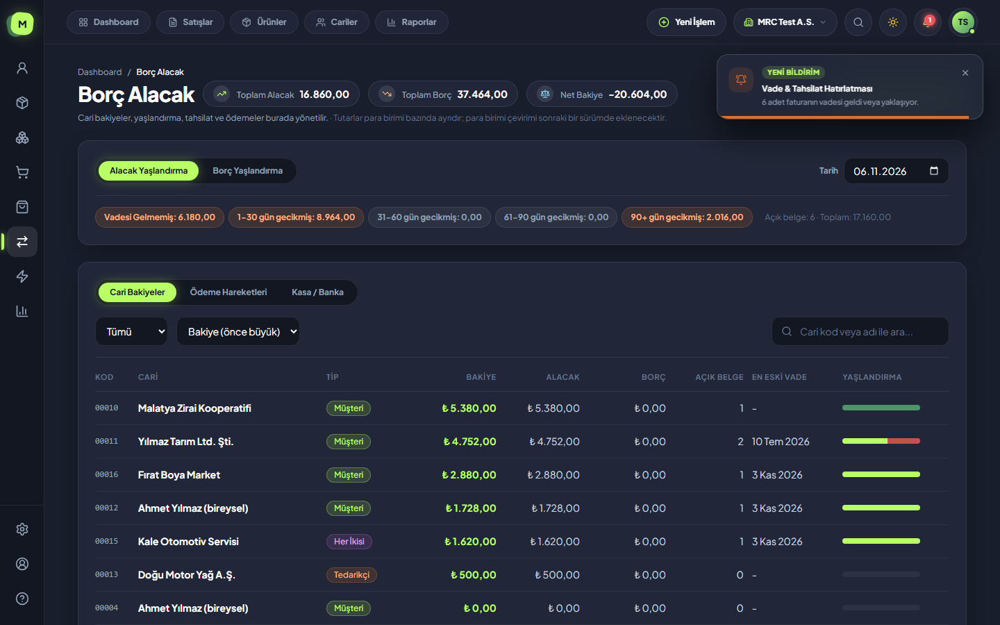

# Borç Alacak

## Bu ekran ne işe yarar?

Kimde ne kadar alacağın, kime ne kadar borcun olduğunu buradan izlersin. Üç işi toplar:

1. **Cari bakiyeler** — her müşterinin/tedarikçinin güncel bakiyesi ve açık belgeleri.
2. **Tahsilat ve ödeme kaydı** — para giriş/çıkışlarını işlediğin yer.
3. **Kasa / Banka hesapları** — paranın hangi kasada veya hesapta durduğu.

Ekranın altında yaşlandırma (**Vadesi Gelmemiş · 1-30 gün gecikmiş · 31-60 · 61-90 · 90+**)
vardır: hangi alacağın ne kadar beklediğini gösterir.

> **Bakiye işaretinin anlamı:** **artı (+) = bizim alacağımız** (müşteri bize borçlu),
> **eksi (−) = bizim borcumuz** (biz ona borçluyuz veya müşteriden erken para aldık).

## Adım adım

### 1) Özet şeridi okuma

Sol menüden **Borç** (üst menüde **Borç Alacak**) seçeneğine tıkla. Başlığın hemen altında
üç sayı vardır:

- **Toplam Alacak** — bakiyesi artı olan carilerin toplamı.
- **Toplam Borç** — bakiyesi eksi olan carilerin toplamı.
- **Net Bakiye** — ikisinin farkı.

Altında şu satır görünür: „Cari bakiyeler, yaşlandırma, tahsilat ve ödemeler burada yönetilir.”
Ayrıca birden fazla para birimi kullanılıyorsa „Tutarlar para birimi bazında ayrıdır; para birimi
çevirimi sonraki bir sürümde eklenecektir.” notu düşer.

### 2) Yaşlandırma tabloları

1. Sağ üstte **Alacak Yaşlandırma** / **Borç Yaşlandırma** düğmeleriyle hangi tarafı
   gördüğünü seç.
2. Yanındaki **Tarih** alanı, hesaplamanın hangi güne göre yapıldığını değiştirir
   (varsayılan bugün).
3. Kovalar: **Vadesi Gelmemiş**, **1-30 gün gecikmiş**, **31-60 gün gecikmiş**,
   **61-90 gün gecikmiş**, **90+ gün gecikmiş**.
4. Altında „Açık belge: 3 · Toplam: 5.400,00” gibi bir özet satırı vardır.

> Belgede **Vade** tarihi yoksa tutar „Vadesi Gelmemiş” kovasına düşer. Bu yüzden
> fatura keserken vade girmeyi alışkanlık edin.

### 3) Cari bakiyeleri listeleme

1. **Cari Bakiyeler** sekmesinde ol.
2. Filtreler: **Tümü / Müşteri / Tedarikçi / Her İkisi**, sıralama
   (**Bakiye (önce büyük)** / **Bakiye (önce küçük)** / **Ada göre** / **En eski vadeye göre**),
   arama kutusu.
3. Tablo kolonları: **KOD · CARİ · TİP · BAKİYE · ALACAK · BORÇ · AÇIK BELGE · EN ESKİ VADE · YAŞLANDIRMA**.
4. Yaşlandırma kolonunda küçük bir çubuk, carinin parasının hangi kovalarda durduğunu gösterir.
5. Satıra tıkla → sağdan **Cari Bakiye Detayı** açılır.

### 4) Cari Bakiye Detayı

Çekmecede şunlar vardır:

- Üstte **kod · tip** ve cari adı, özet toplamlar (satış, tahsilat, alım, ödeme, bakiye).
- **Para birimi tablosu** — her para birimi için ayrı satış/tahsilat/alım/ödeme/bakiye.
- **Yaşlandırma** — o carinin beş kovaya dağılmış tutarları.
- **AÇIK BELGELER** — seri numarası, kesim, vade, genel toplam, tahsil edilen, **kalan** ve
  gecikme günü. Örnek satır: `FTR-26-00002 ₺ 216,00 — Kesim: 30 Eki 2026 · Vade: - · Genel toplam: ₺ 216,00`
- **SON ÖDEMELER** — en son on hareket.
- Altında iki buton: **Tahsilat Al** ve **Ödeme Yap**.

### 5) Tahsilat kaydetme (para girişi)

1. **Yeni Ödeme Kaydet** butonuna bas (veya çekmeceden **Tahsilat Al**).

   > Aynı formu [Raporlar](Raporlar) → **Cari Bakiye** sekmesinden de açabilirsin: orada cari
   > satırını açıp **Tahsilat Al** / **Ödeme Yap** derse bastığında bu ekran, cari **seçili**
   > hâlde açılır.
2. **Yön \*** kutusunda **Tahsilat** seçili olsun.
3. **Cari \*** alanına adı yaz, açılan listeden **seç** (çekmeceden açtıysan dolu gelir).
4. **Tutar \*** alanına pozitifi yaz (örn. `216`).
5. **Para Birimi** (₺ TRY / $ USD / € EUR), **Tarih**, **Yöntem** (**Nakit / Banka / Kart /
   Havale / EFT**) ve **Kasa / Banka** hesabını seç.
6. Belirli bir fatura karşılığında alıyorsan **Bağlı belge** listesinden seç
   (yalnız **İhraç** veya **Kısmen ödendi** belgeler listelenir; örnek:
   `FTR-26-00002 · ₺ 216,00`). Belge seçince para birimi otomatik kilitlenir.
   - Belge **dövizliyse** (örn. USD) formda **Hangi kurla işlensin?** sorusu belirir:
     **Belge kuru** (kesim gününün fotoğrafı) veya **Güncel kur** (bugünün kuru).
     Seçimin altında tutarın TL karşılığı yazar. Kural: belge aynı gün kesildiyse ikisi
     aynıdır; vade geçmişse farklı olur — aradaki fark kur farkıdır, defterde ayrı
     satır olarak görünmez, ödemenin kurunda saklıdır.
7. İstersen **Dekont no** ve **Notlar** alanlarını doldur.
8. **Kaydet**. Ekran şu mesajı verir: „Ödeme kaydedildi. Güncel bakiye: ₺ -300,00”.
9. Tahsilat bir belgeye bağlandıysa faturanın durumu kendiliğinden değişir:
   eksik kaldıysa **Kısmen ödendi**, tamamı tahsil edildiyse **Ödendi**.

### 6) Ödeme kaydetme (para çıkışı)

Aynı form, **Yön** kutusunda **Ödeme** seçili. Tedarikçi carisine yapılır; alım faturasına
bağlanırsa fatura **Kısmen ödendi / Ödendi** olur.

### 7) Kaydı geri alma

**Ödeme Hareketleri** sekmesinde hareketler listelenir (tarih, yön, cari, tutar, yöntem, hesap,
belge, dekont). Satırın sağındaki **Sil** simgesi → „**Ödeme Silinsin mi?**” onayı → **Evet, Sil**.
Silince bağlı belgenin durumu kendiliğinden geri alınır (örn. **Ödendi → İhraç**) ve bakiyeler
tazelenir.

### 8) Kasa / Banka hesabı tanımlama

1. **Kasa / Banka** sekmesine geç („Kasa, banka ve kart hesaplarınızı buradan yönetin.”).
2. Kayıt yoksa „Kayıtlı hesap bulunamadı — İlk kasa veya banka hesabınızı oluşturarak başlayın.”
   yazar. **Yeni Hesap** butonuna bas.
3. Doldur: **Hesap Adı \***, **Tip** (**Kasa / Banka hesabı / Kart hesabı**), **Para Birimi**,
   **IBAN**, **Hesap no**, **Açılış Bakiyesi**, **Notlar**.
4. **Varsayılan** işaretli hesap yeni ödemelerde otomatik önerilir; bir hesabı varsayılan
   yapınca diğerlerinin işareti kendiliğinden kalkar.
5. **Aktif** işaretini kaldırırsan hesap artık seçim listelerinde çıkmaz ama geçmişi bozulmaz.
6. Kartlar güncel bakiyeyi ve kaç ödeme bağlandığını gösterir: „Açılış Bakiyesi: ₺ 0,00 · 0 ödeme”.

## Alan açıklamaları

| Alan | Zorunlu | Boş bırakılırsa | Not |
| --- | --- | --- | --- |
| Yön | Evet | — | Tahsilat = para girişi, Ödeme = para çıkışı |
| Cari | Evet | Kaydedilmez | Tahsilat **Müşteri/Her İkisi**, ödeme **Tedarikçi/Her İkisi** carisine yazılabilir |
| Tutar | Evet | Kaydedilmez | Daima pozitif yaz; yönü zaten **Yön** seçimi belirler |
| Para Birimi | Hayır | **TRY** | Bağlı belge seçiliyse belgenin para birimine kilitlenir |
| Tarih | Hayır | bugün | Raporlar ve yaşlandırma bu tarihi dikkate alır |
| Yöntem | Hayır | **Nakit** | Nakit / Banka / Kart / Havale-EFT |
| Kasa / Banka | Hayır | hesap bağlanmaz | Yalnız **Aktif** hesaplar listelenir; hesabın para birimi ödemeyle aynı olmalı |
| Bağlı belge | Hayır | açık hesap tahsilatı | Yalnız ihraç edilmiş belgeler; tahsilat satış faturasına, ödeme alım faturasına bağlanır |
| Dekont no | Hayır | boş | Arama kutusunda aranabilir |
| Notlar | Hayır | boş | Hareket listesinde simge üzerinde görünür |

## Takıldığınızda

- **„Tutar sıfırdan büyük olmalıdır.”** → Tutarı 0 veya eksi girdin; pozitif yaz.
- **„Bu cari hesap tipi için bu yönde ödeme kaydedilemez.”** → Müşteri carisine „Ödeme”,
  tedarikçi carisine „Tahsilat” yazdın. Cari tipini **Her İkisi** yap veya yönü değiştir.
- **„Seçilen belge bu cari hesaba ait değil.”** → Başka carinin faturasını bağlı belge
  olarak seçtin; doğrusu önce doğru cariyi seçmek.
- **„Seçilen belge bu ödeme için uygun değil.”** → Belge **Taslak/İptal** veya tür yanlış
  (tahsilat satış faturasına, ödeme alım faturasına bağlanır). Önce **İhraç et**.
- **„Ödeme para birimi belge para birimiyle aynı olmalıdır.”** /
  **„Ödeme para birimi hesap para birimiyle aynı olmalıdır.”** → Döviz belgeden veya
  döviz hesapdan işlem yapılamaz; para birimini eşitle.
- **„Pasif hesaba ödeme kaydedilemez.”** → Hesabı **Aktif** yap veya başka hesap seç.
- **„Bu hesapta ödeme kaydı mevcut; silinemez.”** → Hareket görmüş kasa/banka silinmez;
  **Aktif** işaretini kaldırarak pasife al.
- **„Ödeme bulunamadı.”** → Kayıt senin firmandan değil veya zaten silinmiş.
- **Tahsilat yaptım, fatura hâlâ „İhraç”** → Tahsiladı belgenin **bağlı belgesi** boş
  bırakılmış; liste/bakiye doğru ama o fatura açık görünür. Ödemeyi silip belgeye bağlı
  olarak yeniden kaydet.
- **Bakiye beklediğimden farklı** → Çekmecedeki **AÇIK BELGELER** ve **SON ÖDEMELER**
  listelerine bak; vadesiz belgeler „Vadesi Gelmemiş” kovasındadır.

## Bilmenizde yarar var

- Ödemeyi **belgeye bağlamadan** da kaydedebilirsin (açık hesap tahsilatı). Bu durumda
  carinin bakiyesi düşer, belgeler „açık” görünmeye devam eder.
- Belgeye bağlanan tahsilatta **fazla ödeme** engellenmez: örneğin ₺240'lık faturaya
  ₺300 tahsilat kaydedilebilir; belge **Ödendi** olur, kalan ₺60 caride **avans** olarak
  durur ve PDF'te „Fazla ödeme” diye görünür.
- **Bakiye tek noktadan hesaplanır**: açılış bakiyesi + satış − tahsilat − alım + ödeme.
  Liste, çekmece, panel ve raporlar aynı sayıyı gösterir.
- Silinen ödeme kaydı geri getirilemez; yanlış kaydettiysen sil ve yeniden kaydet.
- Para birimi karışık carilerde toplamlar **ayrı ayrı** verilir; sistem dövizleri kendi
  arasında toplamaz.
- Yaşlandırma **vade tarihine** göredir; vade yoksa „Vadesi Gelmemiş” sayılır.
