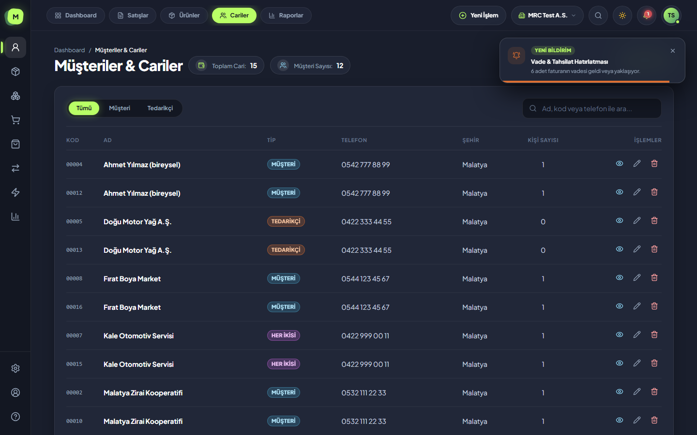

# Cariler

## Bu ekran ne işe yarar?

Kimle çalıştığını buradan tanımlarsın: sana mal satan **tedarikçiler** ve senden mal alan
**müşteriler**. Her kaydın bir kodu olur (`00001` gibi) ve tüm satış/alım belgeleri, ödemeler bu
kayıta bağlanır. Cari kaydının içine yetkili **iletişim kişileri** de eklenir.

## Adım adım

### Cari ekleme

1. Sol menüden **Cari** seçeneğine tıkla.
2. Sağ üstteki **Yeni Cari** butonuna bas.
3. Zorunlu tek alan: **Ad Soyad / Firma adı** (örn. „Ortaklar Motors Ltd. Şti.").
4. **Tip** kutusunu seç:
   - **Müşteri** → sadece satış yapacağın hesap
   - **Tedarikçi** → sadece alım yapacağın hesap
   - **Her İkisi** → aynı firmadan hem alıp hem satıyorsan
5. Dilersen **Telefon**, **E-posta**, **Şehir**, **Açılış Bakiyesi**, **Kredi Limiti**, **Notlar** alanlarını doldur.
6. **Kaydet**. Pencere kapanır, yeni satır listede görünür ve sistem otomatik kod verir (`00001`).

### Cariyi bulma

- Üstteki arama kutusuna ad, kod, telefon, vergi no veya e-posta parçası yaz; liste **yarım saniye içinde** kendini süzer.
- Sekmeler: **Tümü** · **Müşteri** · **Tedarikçi**. „Her İkisi" tipli cariler hem Müşteri hem Tedarikçi sekmesinde görünür.

### Cari detayını açma, düzenleme, silme

1. Satıra tıkla → sağdan **Cari Detayı** penceresi açılır.
2. **GENEL BİLGİLER** bölümünde kod, tip, telefon, e-posta, vergi no, şehir, **Para Birimi**, **Açılış Bakiyesi**, **Kredi Limiti** ve adres görünür.
3. **Düzenle** → alanları değiştirip **Kaydet**.
4. **Sil** → onay penceresi açılır; **Evet, Sil** ile silinir.

### İletişim kişisi ekleme

1. Cari Detayı penceresinde **İLETİŞİM KİŞİLERİ** bölümünü gör.
2. **Yeni Kişi Ekle** (veya alanların altındaki **Kişi Ekle**) butonuna bas.
3. Zorunlu alan: **Ad Soyad \***. İstersen **Ünvan**, **Telefon**, **E-posta** gir.
4. Kişinin yetkili muhatap olması için **Birincil kişi olarak işaretle** kutusunu işaretle.
5. **Kişi Ekle**. Kişi listeye eklenir ve yanında **Birincil** rozeti görünür.

> Bir caride **yalnızca bir** birincil kişi olur. İkinci bir kişiyi birincil yaparsan, önceki kendiliğinden sıradan kişiye döner.

## Alan açıklamaları

| Alan | Zorunlu | Boş bırakılırsa | Not |
| --- | --- | --- | --- |
| Ad Soyad / Firma adı | Evet | Kayıt açılmaz | Listede bu ad görünür, belgelerde de bu ad kullanılır |
| Tip | Evet (varsayılan: Müşteri) | Müşteri olarak kaydedilir | Yanlış seçersen detaydan düzenleyebilirsin |
| Telefon, E-posta, Şehir, Adres | Hayır | Boş gösterilir | Aramada telefon ve e-posta da aranır |
| Vergi No | Hayır | „-" görünür | Aramada vergi no da aranır |
| Para Birimi | Hayır | **firmanın para birimi** ([Ayarlar](Ayarlar) → Para Birimi) | İleride dövizli işlem yapacaksan ilgili para birimini seç; belgeler ve ödemeler bu para biriminde açılır |
| Açılış Bakiyesi | Hayır | 0 kabul edilir | Sistemi kurarken o carinin eski borcunu/alacağını buraya yaz |
| Kredi Limiti | Hayır | Limit yok | Uyarı amaçlıdır, işlemi engellemez |
| Kişi Ad Soyad | Evet | Kişi eklenmez | — |

## Takıldığınızda

- **„Cari kaydı bulunamadı."** → Cari senin firmana ait değil veya silinmiş. Listeyi yenile; üstteki firma adına bak.
- **Sil butonu çalışmıyor / uyarı çıkıyorsa** → O cariye bağlı belge veya ödeme vardır; sistem geçmişin kaybolmaması için izin vermez: „**Bu cari hesap silinemez: bağlı belge veya ödeme kaydı var.**" Cari silmek yerine kaydı düzenle veya kullanmayı bırak.
- **Liste boş görünüyor** → Üstte **Kayıtlı cari bulunamadı** yazıyordur: arama kutusunda yazı kalmış olabilir, kutuyu temizle veya **Tümü** sekmesine geç.
- **Başka firmadaki cari görünüyor gibi** → Üst menüdeki firma adı senin bağlamındadır; iki firman varsa doğru olanı seç.

## Bilmenizde yarar var

- Cari kodu (`00001`) **elle yazılmaz**, sistem sıra ile verir ve firmanda benzersizdir.
- **Açılış Bakiyesi** bakiye hesabına eklenir; sonradan fatura/ödeme ile büyür veya kapanır.
- Cari listesindeki **KİŞİ SAYISI** sütunu, o caride kaç iletişim kişisi olduğunu gösterir.
- Ekranın üstündeki **Toplam Cari** ve **Müşteri Sayısı** hapları, filtreden bağımsız olarak firmanın genel sayısını gösterir.
- Geçmiş işlemi olan cari silinemez; kullanmak istemiyorsan artık ona belge kesme.
