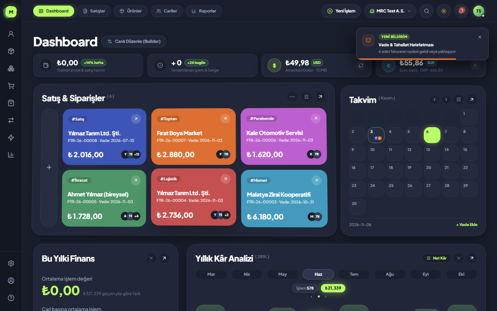

# Hızlı Başlangıç — ilk 15 dakika

Amaç: boş sistemden ilk satışa giden en kısa yol. Sırayı bozma; her adım bir sonrakini hazırlar.

## 1. Kayıt ol (1 dk)

1. **Kayıt Ol** ekranını aç.
2. Dört alanı doldur: **Ad Soyad**, **E-posta**, **Parola** (en az 8 karakter), **Firma adı**.
3. **Kayıt Ol** butonuna bas. Otomatik olarak giriş yapılırsın.

Kayıt sırasında sistem senin için şunları **hazır** getirir (elle yapmana gerek yok):

- Senin firmanın kaydı ve **Admin** rolün
- **Ana Depo** (varsayılan depo)
- **Adet** birimi

## 2. Bir müşteri tanıt (2 dk)

1. Sol menüden **Cari** → **Cariler** ekranını aç.
2. **Yeni Cari** butonuna bas.
3. Zorunlu tek alan **Ad Soyad / Firma adı**. Telefon ve şehir gibi alanlar boş bırakılabilir.
4. **Tip** olarak **Müşteri** seç. (Aynı firma hem alım hem satım yapıyorsa **Her İkisi**.)
5. **Kaydet**. Sistem cariye otomatik kod verir (`00001` gibi) ve satır listede görünür.

## 3. Ürün için kategori ve birim (2 dk)

1. Üst menüden **Ürünler** ekranını aç (sol sütundaki koli simgesi: „Ürünler & Hizmetler"), üstteki **Tanımlar** sekmesine geç.
2. **Yeni Kategori** alanına bir ad yaz (örn. „Gıda"), renk seç ve **Ekle**.
3. Birim zaten **Adet** olarak hazır. Gerekirse **Yeni Birim** ile „kg", „litre" gibi birimler ekle.

> Neden bu sıra? Satış belgeleri **ürün** ister; ürün de **kategori** ve **birim** ister.

## 4. İlk ürünü aç (3 dk)

1. **Ürünler** sekmesine dön → **Yeni Ürün**.
2. Doldur: **Ad**, **Kategori**, **Birim**, **Alış fiyatı**, **Satış fiyatı**, **KDV oranı**,
   **Min. Stok** (kritik uyarı eşiği), **Stok takibi** anahtarı.
3. **Kaydet**. Ürün listelenir; stok kolonunda başta **0** görünür (henüz mal girişi yok).

## 5. Stoğa mal koy (3 dk)

1. **Stok** ekranını aç → **Manuel Hareket**.
2. Seç: **Ürün**, **Depo** (Ana Depo), **Hareket Tipi: Giriş**.
3. **Miktar** (örn. 10) ve **Birim Maliyet** (örn. 25,5) gir, istersen **Not** yaz.
4. **Kaydet**. Mesaj güncel stoğu gösterir; hareket listesinde „Giriş · +10" satırı belirir.

Bu andan sonra: ürünün anlık stoğu, kritik stok uyarısı ve depodaki miktar doğru çalışır.

## 6. İlk satışı yap (4 dk)

1. Üst menüden **Satışlar** → **Yeni Belge**.
2. En kısa yol **Belge Tipi: Fatura**; teklifli yol **Teklif** → belge detayında **Siparişe dönüştür**
   → **Faturaya dönüştür**. Her aşama yeni numara alır (`TEK-26-00001` → `SIP-…` → `FT-…`).
3. **Müşteri \*** alanından cariye tıkla, satırlarda **Ürün seç** (veya serbest kalem yaz),
   **Miktar** ve **Birim Fiyat** gir → **Kaydet**.
4. Satırdaki **Görüntüle** simgesi → sağdan açılan pencerede **İhraç et**.
   **Bu anda stok düşer** ve ürünün maliyeti satıra yazılır.
5. **Borç Alacak** → **Yeni Ödeme Kaydet** → müşteri, tutar ve ödeme yöntemi (Kasa/Banka) → **Kaydet**.
   Belgenin durumu **Ödendi** (kısmi ödemeyle **Kısmen ödendi**) olur.

Teklif ve sipariş stoğu **düşürmez**; stok **fatura ihraç edildiğinde** hareket eder.
Ayrıntı ve ekran görüntüleri: [SUREC-TEKLIF-SATIS](SUREC-TEKLIF-SATIS) · [Satislar](Satislar) · [Borc-Alacak](Borc-Alacak).

## 7. Personel ekle (2 dk)

1. Sol sütundaki **Kullanıcılar & Roller** simgesine tıkla (üstte „Ekip & Davet Yönetimi" yazar).
2. **Yeni Üye Davet Et** kutusunda **E-posta Adresi \*** ve **Rol** (**Admin** / **Personel**) seç
   → **Davet Et**. Davet „bekliyor" olarak **Davet Geçmişi**ne düşer.
3. Bu sürümde e-posta gönderilmez: kişi kendi ad ve e-postasıyla **hesap oluşturup giriş yapınca**
   ekranının üstünde **„Seni bekleyen davetler var"** şeridi görür → **Kabul et** → o firmanın
   paneline geçer (birden fazla firmadaysan üstteki firma seçiciden geçebilirsin).

**Admin** her şeyi görür ve ayarları değiştirir; **Personel** günlük işlemleri yapar
(Ayarlar'ı **değiştiremez**, davet gönderemez). Ayrıntı: [ROL-REHBERI](ROL-REHBERI).

## 8. İstersen dili değiştir

**Ayar** → **Ayarlar** → **Dil**: **Türkçe** / **English**. Tercihin hesabına kaydedilir;
açılışlarda ve sonraki işlemlerde aynı dil kullanılır. Sayı ve tarih biçimi de dile göre değişir.

---

**Kontrol listesi** — bunlar tamamsa sistemin temeli kurulu demektir:

- [ ] En az bir cari (müşteri)
- [ ] En az bir kategori
- [ ] En az bir ürün (kategori + birim bağlı)
- [ ] Ürüne en az bir „Giriş" hareketi (stok 0'dan farklı)
- [ ] İlk fatura kesildi ve **ihraç** edildi (stok düştü, maliyet satıra yazıldı)
- [ ] İlk tahsilat kaydedildi (belge **Ödendi** veya **Kısmen ödendi**)
- [ ] Gerekirse ikinci kullanıcı daveti
