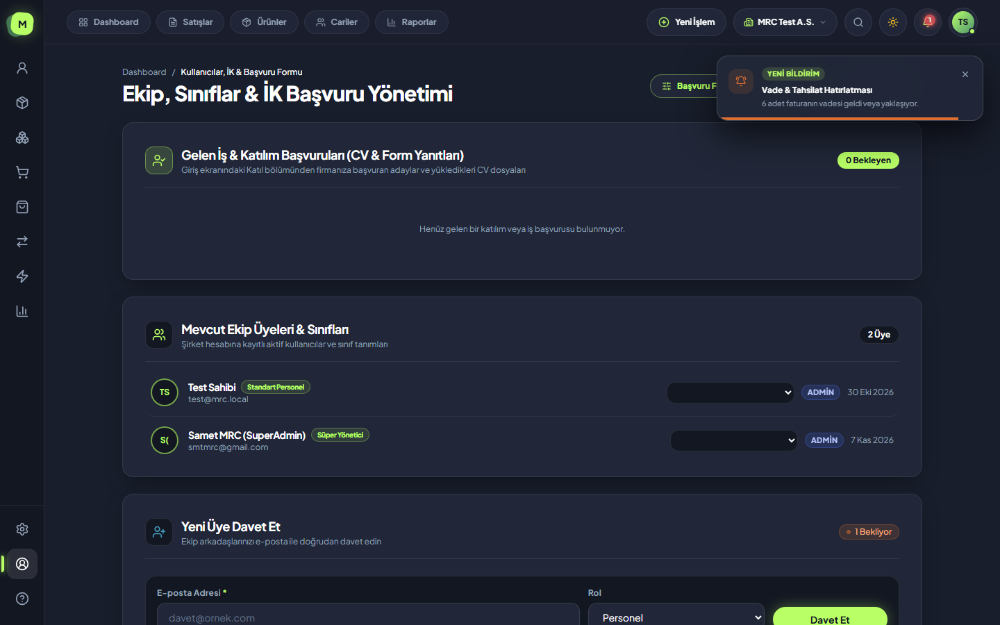
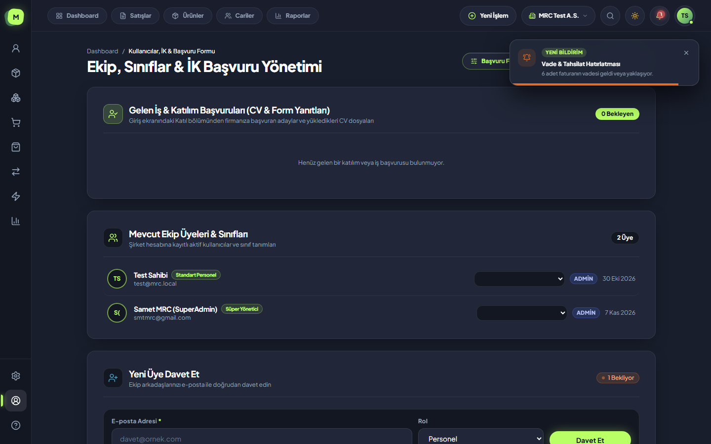

# Kullanıcılar & Roller

## Bu ekran ne işe yarar?

Firmanınla birlikte çalışacak kişileri buradan davet edersin ve kimin ne görebileceğini
**rol** ile belirlersin. Ekranın adı **Kullanıcılar & Roller**, başlığı **Ekip & Davet Yönetimi**.

## Adım adım

### 1) Ekibi görme, Özel Kullanıcı Sınıfları ve CV Başvuru Formu Kurucu

1. Sol menüden **Ayar** → **Kullanıcılar & Roller** ekranını aç.
2. Üstteki haplar: **Bekleyen Davet** sayısı, **Gelen Başvuru** sayısı ve **Ekip Aktif** sayısı.
3. **Mevcut Ekip Üyeleri** kutusu yanında toplam **Üye** sayısını taşır. Her satırda kişinin adı/e-postası, rolü (**Admin** veya **Personel**) ve varsa **Özel Kullanıcı Sınıfı** (örn. _Muhasebe Şefi_, _Depo Sorumlusu_) görünür.
4. **Başvuru Formu Kurucu:** Giriş ekranındaki **Katıl** sekmesinden firmanıza başvuracak adayların hangi alanları dolduracağını (Telefon, Deneyim Yılı, Eğitim, Pozisyon, **CV / Özgeçmiş Dosyası Yükleme [PDF/DOCX]** vb.) sürükle-bırak ile sıralayabilir, zorunlu/opsiyonel yapabilir, yeni özel soru ekleyebilir veya **Orijinale Dön** ile varsayılan forma sıfırlayabilirsiniz.
5. **Gelen Katılım & İş Başvuruları:** Başvuru yapan adayların yanıtlarını ve yükledikleri **CV dosyasını** tek tıkla indirip inceleyebilir, **Onayla & Personel Ekle** ile anında ekibinize dahil edebilirsiniz.

### 2) Yeni üye davet etme

1. **Yeni Üye Davet Et** kutusunu bul („Ekip arkadaşlarınızı e-posta ile davet edin").
   Sağında bekleyen davet sayısı için **Bekliyor** rozeti durur.
2. **E-posta Adresi \*** alanına kişinin e-postasını yaz (örn. `davet@ornek.com`).
3. **Rol** kutusundan seç: **Personel** (günlük işlemler) veya **Admin** (her şey + ayarlar).
4. **Davet Et** butonuna bas. Davet **Davet Geçmişi** listesine düşer; yanında
   „Gönderildi: …" ve „Son: …" (geçerlilik bitişi) yazar.
5. Davetin **satırındaki çan/sil simgesi** → **Daveti İptal Et**.

> Davet **7 gün** geçerlidir ve **tek kullanımlıktır**. Kişi, davet edilen **e-posta adresiyle**
> sisteme girip davetini kabul ettiğinde senin firmana bağlanır.

### 3) Daveti geri alma

1. **Davet Geçmişi** satırındaki **Daveti İptal Et** simgesine tıkla.
2. Onay penceresi: „**Davet İptal Edilsin mi?** — Bu işlem geri alınamaz.
   **ahmet@firma.com** adresine gönderilen davet bağlantısı geçersiz kılınacaktır."
3. **Evet, İptal Et** (vazgeçmek için **Vazgeç**).

### 4) Daveti kabul etme (davet edilen kişi ne yapar?)

E-posta gönderimi bu sürümde yapılmadığı için Admin'in davetliden istediği tek şey **doğru
e-posta adresiyle sisteme girmesidir**: davet, o adrese bağlı hesapta kendiliğinden görünür.
Davet ekranı bağlantı/token göstermez; token yalnız davetlinin kendi ekranında çalışır.

1. Kişi, **davet edilen e-posta adresiyle** giriş yapar (hesabı yoksa önce
   **Kayıt ol** ile kendi hesabını/firmasını açar).
2. Hangi ekranda olursa olsun sayfanın üstünde yeşil şerit çıkar:
   **„Seni bekleyen davetler var"** — „Bir firma seni çalışmaya davet etti.
   Kabul edince o firmanın ekibine katılırsın."
3. Şeridin her satırında: **„:company firması seni :role rolüyle bekliyor."**,
   **Son katılım tarihi:** ve **Davet e-postası:** yazar. Sağda **Kabul et**.
4. **Kabul et** → şerit „**Davet kabul edildi.**" başlığına döner.
   - Kişinin başka firması yoksa sistem onu **otomatik olarak o firmaya bağlar**;
     üstteki firma adı hemen davet eden firmayı gösterir.
   - Kişinin zaten bir firması varsa („bağlamı" bozulmaz) şeritte
     „**Artık … firmasının da üyesin. O firmada çalışmak için bağlamı değiştirebilirsin.**"
     ve yanında **Bu firmaya geç** butonu çıkar. Basınca ekran o firmanın verileriyle yenilenir.
5. Şeridi bugünlük kapatmak istersen sağındaki **Kapat** simgesini kullan; yeni girişte
   davet yine görünür. Kabul edilince bekleyen davet sayısı **Bekleyen Davet** hapsından düşer.

**Bağlantı kısayolu (`?invite=<token>`):** Bu sürümde hiçbir ekran token'ı göstermez; kişiyi
davetine ulaştırmak için **e-posta adresinin tutması yeterlidir**. Bağlantı, e-posta gönderimi
eklendiğinde çalışacak köprüdür ve hazır: açıldığında ilgili satır **parlak çerçeveyle** öne
çıkar, giriş yapılmamışsa önce giriş/kayıt ekranı açılır ve giriş sonrası o satır yine
karşısına gelir. İki güvenlik kuralı vardır: bağlantı **yalnız o e-postayla giriş yapan
kişide** çalışır ve **token adres çubuğunda bırakılmaz** (işlendikten sonra adresten düşürülür).
Bağlantı kişiye ait değilse ya da davet düşmüşse şeritte „**Bu davet senin e-postana
gönderilmemiş, süresi geçmiş ya da zaten kabul edilmiş görünüyor.**" yazar.

## Alan açıklamaları

| Alan | Zorunlu | Boş bırakılırsa | Not |
| --- | --- | --- | --- |
| E-posta Adresi | Evet | Davet açılmaz | Kişi bu adrese sahip bir hesapla kabul etmelidir |
| Rol | Evet (varsayılan: Personel) | Personel | Admin, ayar ve kullanıcı işlemlerini de yapabilir |
| Son (geçerlilik) | — | — | Sistem 7 gün sonrasını yazar |

## Roller ne yapabilir?

Bu tablo sistemin **kendi kurallarından** alınmıştır (sunucuda denetlenir):

| İşlem | Admin | Personel |
| --- | --- | --- |
| Cari, ürün, kategori, birim, depo tanımları | Evet | Evet |
| Stok hareketi: Giriş / Çıkış / **Düzeltme** | Evet | Evet |
| Belge oluşturma, ihraç etme, dönüştürme, PDF alma | Evet | Evet |
| Taslak belgeyi düzenleme / silme | Evet | Evet |
| Cari / ürün / depo silme (hareket görmemişse) | Evet | Evet |
| Tahsilat / ödeme kaydı ve silme, kasa-banka tanımları | Evet | Evet |
| Raporlar ve panel | Evet | Evet |
| **Ayarlar → Genel Ayarlar** (para birimi, KDV, vade, seri öneki) | Evet | **Hayır — 403** |
| **Ayarlar → Firma Bilgileri ve logosu** | Evet | **Hayır — 403** |
| **Kullanıcı davet etme / davet iptali** | Evet | **Hayır — 403** |
| Ekibi ve davet geçmişini **görüntüleme** | Evet | Evet |
| Dil tercihi (kendi dili) | Evet | Evet |
| **İki faktörlü giriş** (kendi hesabı) | Evet | Evet |

> Personel yasak bir işlemi denersenin ekranda **„Bu işlem için yönetici yetkisi gereklidir."** çıkar.
> Ayrıntılı rehber: [ROL-REHBERI](ROL-REHBERI).

### 5) Hesabını iki faktörlü girişle koruma (herkes kendi hesabı için)

Şifren çalınsa bile hesabın açılmasın istiyorsan [Ayarlar](Ayarlar) ekranındaki
**İki Faktörlü Giriş** kartını aç (Admin olman gerekmez — herkes kendi hesabını korur):

1. **Kuruluma başla** → ekrandaki gizli anahtarı telefonundaki doğrulama uygulamasına
   yaz (Google/Microsoft Authenticator vb., „Kurulum anahtarını gir").
2. Uygulamada beliren 6 haneli kodu **Onayla ve etkinleştir** ile doğrula.
3. Beliren **8 yedek kodu** güvenli bir yere yaz — bir daha gösterilmez.
   Telefonun yanındayken giriş kodla, değilken yedek kodlardan biriyle girilir
   (her yedek kod tek kullanımlıktır).
4. Kapatmak veya kodları yenilemek istersen şifreni girerek yaparsın.

Sayfayı kurulum ortasında yenilediysen eski kod geçersizdir; **Kuruluma başla** ile
yeni kod üret. Girişte 5 kez yanlış kod girersen sınama kapanır — e-posta + şifreyle
baştan giriş yaparsın.

### 6) Açık oturumları görme ve kapatma (herkes kendi hesabı için)

[Ayarlar](Ayarlar) ekranındaki **API Erişim Anahtarları** kartının listesinde her
satırın altında cihaz bilgisi yazar („Chrome · Windows · 127.0.0.1" gibi).
Tanımadığın bir cihaz görürsen (örn. bilmediğin bir şehirden giriş):

1. Önce şifreni değiştir (bu ekranda şifre değişimi yoksa yöneticinden iste).
2. Listede **Diğer oturumları kapat** → **Evet, diğerlerini kapat**: şu an
   kullandığın oturum açık kalır, geri kalan her yerden çıkış yapılır.
3. Ürettiğin **API anahtarları** (masaüstü/terminal bağlantıları) bu işlemden
   etkilenmez — onları tek tek **İptal et** ile kapatırsın.

## Takıldığınızda

- **„Bu e-posta için bekleyen bir davet zaten var."** → Aynı kişiye ikinci davet açılamaz.
  **Davet Geçmişi**nden eski daveti **Daveti İptal Et** ile kapat, sonra yeniden davet et.
- **„Bu davet zaten kullanıldı."** → Bağlantı tek kullanımlıktır; kişinin hesabı artık bağlıdır.
- **„Davet süresi geçmiş."** → 7 günü aşmış; yeni davet oluştur.
- **„Bu davet farklı bir e-posta adresine gönderildi."** → Kişi başka bir hesapla giriş yapıyor;
  doğru e-postayla giriş yapmasını sağla veya yeni davet oluştur.
- **„Bu firmanın üyesi değilsiniz."** → Seçili firma bu hesaba bağlı değil; üstteki firma
  seçicisinden doğru firmayı seç.
- **„Bu işlem için yönetici yetkisi gereklidir."** → Personel rolüyle ayar/kullanıcı işlemi
  yapıyorsun; işlemi bir Admin yapmalı.
- **Kişi e-postasını aldı ama daveti göremiyorsa** → Üç nedeni sırayla kontrol et:
  1. **Yanlış hesapla mı giriş yapıyor?** Davet, yalnız **davet edilen e-postanın** hesabında
     görünür. Üst sağdaki kullanıcı adına/e-postasına baktır.
  2. **Bağlamı başka firma mı?** Şerit hangi ekranda olursa görünür; göremiyorsa sayfayı
     yeniletsin (**F5**) veya çıkış-giriş yapsın.
  3. **Davet düşmüş mü?** 7 gün geçtiyse veya kişi daha önce kabul ettiyse liste boşalır;
     **Kullanıcılar & Roller → Davet Geçmişi**nden durumuna baktır, gerekirse yeni davet aç.
- **„Bu davet senin e-postana gönderilmemiş, süresi geçmiş ya da zaten kabul edilmiş
  görünüyor."** → Bir `?invite=<token>` bağlantısı açıldı ama o davet bu hesaba ait değil
  (ya da süresi doldu/kullanıldı). Doğru e-postayla giriş yap; davet hâlâ duruyorsa şeritteki
  **Kabul et** yeterli, bağlantıya gerek yok.
- **Kabul etti ama ekranı kendi firmasının verilerini gösteriyor** → Kişinin önceden açtığı bir
  firma varsa sistem bağlamı kendiliğinden değiştirmez. Şeritteki **Bu firmaya geç** butonuna
  bassın veya üstteki firma seçicisinden davet eden firmayı seçsin.
- **„Firmaya geçilemedi." / „Davet kabul edilemedi."** → Oturum düşmüş olabilir; tekrar giriş
  yapıp şeritten yeniden denerse geçer. Davet bu arada biri tarafından iptal edilmiş de olabilir.
- **Yeni üyenin ekranı boş görünüyor** → Yeni üye kendi firmasını seçmiş olabilir; üstteki firma
  adına baktır.

## Bilmenizde yarar var

- Bir kullanıcı **birden fazla firmanın** üyesi olabilir; her seferinde tek firma bağlamında çalışır.
- Firmalar arası veriler karışmaz: başka firmanın cari/ürün/belge kayıtları hiçbir ekranda görünmez.
- Firma ilk kurulduğunda kaydı yapan kişi otomatik **Admin** olur.
- Rolü değiştirilecek kişi için: daveti iptal edip doğru rolle yeniden davetlemek en temiz yoldur.
- **Silinen kullanıcının** açtığı belgeler ve hareketler silinmez; kayıt kimde yapıldıysa öyle kalır.
