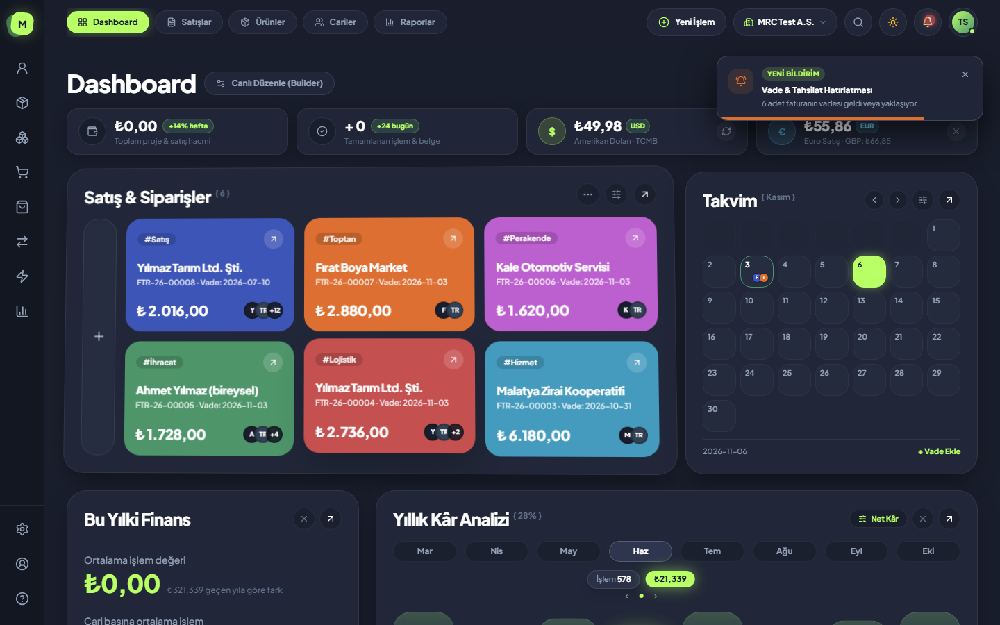

# Panel (Dashboard)

## Bu ekran ne işe yarar?

Günün başlangıç ekranı. İşin özetini **küçük kutular (widget)** hâlinde gösterir:
bu ay ne sattın, hangi faturaların vadesi geliyor, kur ne, kritik stok var mı.
Hangi kutunun görüneceğine **sen** karar verirsin ([Paneli düzenle](#)).

> Panel salt okunurdur; tahsilat/ödeme veya belge kesme işlemleri ilgili ekranlardadır.
> Sayılar sayfa açıldığında sunucudan gelir; işlem yaptıktan sonra **sayfayı yenile**.

## Adım adım

### 1) Ekranı aç

Sol menüden **Panel** (üst menüde **Dashboard**). Sağ üstte **Yeni İşlem** butonu vardır:
yeni belge kesmek için **Satışlar** ekranını açar.

### 2) Widget'lar

Her kutu bir soruyu cevaplar. Para tutarları **para birimine göre ayrı** yazılır
(USD + TRY tek sayıda toplanmaz).

| Kutu | Ne gösterir |
| --- | --- |
| **KPI Hapları** | Bu ay ciro (belge adediyle) + açık alacak/borç |
| **Ciro Trendi** | Son 6 ayın satış çubukları (en yüksek aya göre ölçekli) |
| **Vade Takvimi** | Önümüzdeki 30 günün vadeleri (belge, cari, kalan tutar) |
| **Kur Göstergesi** | Döviz kurları (günlük çekilir; [Ayarlar](Ayarlar) → Döviz) |
| **Kritik Stok** | Minimumun altına düşen ürünler (stok / minimum) |
| **Son Hareketler** | Denetim kaydından son olaylar (yalnız yöneticiler görür) |
| **Borç/Alacak Özeti** | Müşteri/tedarikçi açık toplamları |
| **Nakit Akışı Dalga Grafiği** | Giren tahsilat ve çıkan ödeme nakit akışının 6 aylık dalga analizi |
| **Kategori Pasta Grafiği** | Sektör ve kategori bazlı satış cirolarının pasta (donut) dağılımı |
| **Alacak & Borç Sütunları** | 0-30, 31-60, 61-90 ve 90+ gün vade dilimlerine göre bakiye sütunları |
| **Lider Cariler** | En yüksek işlem hacmine sahip müşteri ve iş ortakları |
| **İK & Katılım Başvuruları** | Firmaya gelen CV'li başvurular ve başvuru formu özeti |
| **Modüler Plugin Merkezi** | Tak-çıkar eklentileri ve modülleri anında etkinleştirme/devre dışı bırakma |

### 3) Canlı Görsel Düzenleyici ile Paneli Düzenle & Orijinale Dön

Başlığın yanındaki **Canlı Düzenle** butonuna bastığında ekran canlı tasarım moduna geçer:

1. **Sürükle & Bırak:** Herhangi bir kartı doğrudan fareyle tutup sağa, sola, yukarı veya aşağı sürükleyerek yerini değiştir.
2. **Boyutlandır (`1/3 · 1/2 · 2/3 · Tam`):** Kartların üstündeki boyut düğmeleriyle genişliklerini 12 sütunlu ızgarada canlı olarak büyüt veya küçült.
3. **Gizle / Göster:** İstemediğin kutuyu `✕` düğmesiyle kapat veya üstteki düzenleme çubuğundan tek tıkla geri aç.
4. **Orijinale Dön:** Yerleşimi veya boyutları bozarsan **Orijinale Dön** butonuna basarak fabrika varsayılanı tasarıma anında geri dönebilirsin.
5. **Kapsam Seçimi & Kaydet:** **Benim panelim**, **Rol** (Admin/Personel) veya **Firma varsayılanı** seçip **Yerleşimi Kaydet** düğmesine bas.

### 4) Bildirim Çanı, Sağ Üst Masaüstü Popup ve Açık/Koyu Tema

- **Bildirim Çanı (`🔔`):** Üst barda yer alan çan simgesi okunmamış bildirim olduğunda kırmızı nokta ve sayaç gösterir. Yeni bir bildirim geldiğinde masaüstünde **sağ üstten otomatik kaybolan şık bir popup** açılır. Bildirimleri tek tek veya topluca okundu işaretleyebilir ya da silebilirsin.
- **Açık / Koyu Tema (`☀ / 🌙`):** Cihazının (Windows, macOS, iOS, Android) varsayılan temasına otomatik uyum sağlar; üst bardaki güneş/ay simgesiyle istediğin an Gece (Koyu) veya Gündüz (Açık) moduna geçiş yapabilirsin.

- Yönetici bir kutuyu firma varsayılanında kapatırsa herkesten gider; geri açınca
  tanımı korunur (yeniden kurmak gerekmez).
- Personel **Son Hareketler** kutusunu kendine açamaz (denetim yöneticinindir);
  açmaya çalışırsa sistem reddeder.

## Alan açıklamaları

| Gördüğün alan | Ne gösterir | Not |
| --- | --- | --- |
| Bu ay ciro | Aybaşından bugüne **ihraç edilmiş** faturaların toplamı | Taslak/iptal belgeler sayılmaz |
| Açık alacak / Açık borç | Ödenmemiş belgelerin kalan tutarı | Kısmen ödenmiş belgenin **kalanı** sayılır |
| Kur | 1 birim döviz = kaç TRY + hangi günün kuru | Kurlar günlük çekilir |
| Kritik stok | Minimumun altındaki ürünler | Eşik [Ürünler](Urunler) kartındadır |

## Takıldığınızda

- **Rakamlar sıfır görünüyor** → O dönemde iş yapılmamıştır; sıfır bir hata değildir.
- **„Panel yüklenemedi."** → Geçici bağlantı sorunu; sayfayı yenile.
- **„Katalog yüklenemedi."** → Düzenleme açılırken bağlantı düştü; kapatıp yeniden dene.
- **Kutu görünmüyor** → Ya kapsamda kapalıdır ya rolün havuzunda yoktur. Önce
  **Paneli düzenle** → **Benim panelim** listesine bak; orada da yoksa yöneticin o kutuyu
  rolün için kapatmış olabilir.
- **Sayılar beklediğim firmaya ait değil** → Üstteki **firma adına** bak; panel açık olan
  firmayı gösterir.

## Bilmenizde yarar var

- Panel ızgarası **sana özeldir**: senin gizlediğin kutu başkasını etkilemez.
  Yöneticinin firma/rol düzeyinde kapattığı kutu herkesten gider.
- Ekrandaki tüm metinler gibi panel etiketleri de çift dillidir; dili
  [Ayarlar](Ayarlar) ekranından değiştirirsin.
