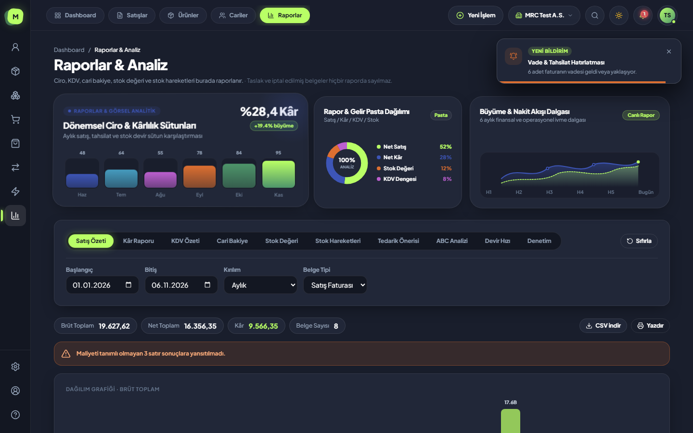

# Raporlar

## Bu ekran ne işe yarar?

İşinin sayısal dökümünü buradan alırsın. Beş sekme vardır:

1. **Satış Özeti** — ne kadar sattın, ne kadar kâr ettin (gün/ay/kategori/ürün/cari kırılımı).
2. **KDV Özeti** — hangi vergi oranında ne kadar matrah ve KDV topladın.
3. **Cari Bakiye** — kimde ne kadar alacağın/borcun var, hangi belge açık.
4. **Stok Değeri** — depoda duran malın maliyet ve satış değeri.
5. **Stok Hareketleri** — ne girdi, ne çıktı, ne kadar telafi/ Sayım düzeltmesi yapıldı.

Ekranın üstünde şu satır durur: „Ciro, KDV, cari bakiye, stok değeri ve stok hareketleri
burada raporlanır. · **Taslak ve iptal edilmiş belgeler hiçbir raporda sayılmaz.**”

> **En önemli kural:** Sayılar **belgenin kesim tarihine** (**Başlangıç/Bitiş** alanları) göre
> toplanır. Stok hareketlerinde ise hareketin **oluştuğu gün** esas alınır.

## Adım adım

### 1) Ekranı aç

Sol menüden **Rapor**, üst menüden **Raporlar** seçeneğine tıkla. Başlık: **Raporlar & Analiz**.

### 2) Satış Özeti

1. **Başlangıç** ve **Bitiş** tarihlerini seç (açılışta bu yılın başı → bugün gelir).
2. **Kırılım**: **Günlük · Aylık · Kategoriye göre · Ürüne göre · Cariye göre**.
3. **Belge Tipi**: **Satış Faturası** (ciro) veya **Alım Faturası** (gider/alım tarafı).
4. Üstteki kartlar: **Brüt Toplam · Net Toplam · Kâr · Belge Sayısı**.
5. **Dağılım grafiği · Brüt Toplam** bölümünde her kırılım için bir çubuk görürsün;
   çubuğun üzerine gelirsen o dönemin tutarını okursun.
6. Tablo kolonları: **AY (veya Grup) · BRÜT TOPLAM · NET TOPLAM · İSKONTO TOPLAMI ·
   KDV TOPLAMI · MALİYET TOPLAMI · KÂR · BELGE SAYISI**. Kâr pozitifse yeşil, negatifse kırmızıdır.
7. Sağ üstte iki buton: **CSV indir** ve **Yazdır** (liste boşken kapalıdır).

> **Kâr** = iskonto ve KDV sonrası net satış − (ürünün **birim maliyeti × satılan miktar**).
> Bazı satırların maliyeti tanımlı değilse turuncu uyarı çıkar:
> „**Maliyeti tanımlı olmayan 3 satır sonuçlara yansıtılmadı.**”

### 3) KDV Özeti

1. **Başlangıç/Bitiş** seç.
2. Kartlar: **Matrah (KDV hariç) · KDV Toplamı · Brüt Toplam · Kalem Sayısı**.
3. Tablo: **VERGİ ORANI · PARA BİRİMİ · MATRAH (KDV HARİÇ) · KDV TOPLAMI · BRÜT TOPLAM · KALEM SAYISI**.
4. Alt satır tüm oranların **Toplam**'ıdır.
5. Sağda **CSV indir / Yazdır**.

> KDV **matrahı** iskonto düşülmüş tutardır; **brüt** = matrah + KDV.
> Örnek: matrah 2.056,35 + %20 KDV 411,27 = brüt 2.467,62.

### 4) Cari Bakiye

1. Filtreler: **Cari Tipi** (**Tümü / Müşteri / Tedarikçi / Her İkisi**), **Sıralama**
   (**Bakiye (önce büyük) / Bakiye (önce küçük) / Ada göre / En eski vadeye göre**),
   **Tarih** (hesaplamanın hangi güne göre olduğu), **Ara** kutusu.
2. Üstte **Alacak Yaşlandırma** / **Borç Yaşlandırma** blokları: **Vadesi Gelmemiş ·
   1-30 gün gecikmiş · 31-60 gün gecikmiş · 61-90 gün gecikmiş · 90+ gün gecikmiş**
   ve **En açık cariler** listesi.
3. Tablo kolonları: **KOD · CARİ · TİP · PARA BİRİMİ · BAKİYE · ALACAK · BORÇ ·
   AÇIK BELGE · EN ESKİ VADE**.
4. Alt bilgi: „Pozitif bakiye alacağımızı, negatif bakiye borcumuzu gösterir.”
5. Satıra tıkla → **Cari Bakiye Detayı** çekmecesi açılır. Buradaki **Tahsilat Al** /
   **Ödeme Yap** butonları seni **Borç Alacak** ekranına götürür; form o cariyle **açık** gelir.
6. Sayfa uzunsa **Önceki / Sonraki** ile ilerle: „Toplam 37 kayıt · Sayfa 1 / 3”.
   **CSV indir** bu listede **tüm sayfaları** indirir (ekranda 15 satır görünmesi
   dosyanın 15 satır olacağı anlamına gelmez); düğme sayfaları çekerken kısa bir süre
   „yükleniyor” hâlinde kalır.

### 5) Stok Değeri

1. **Depo** (**Tüm depolar** veya tek depo) ve **Kategori** (**Tüm kategoriler**) seç.
2. Kartlar: **Ürün Sayısı · Stok Değeri · Satış Değeri · Kritik Stok**.
3. Tablo: **ÜRÜN · SKU · BİRİM · MİKTAR · BİRİM MALİYET · STOK DEĞERİ · SATIŞ FİYATI ·
   SATIŞ DEĞERİ · MİN. STOK · DURUM** (**Kritik** / **Normal**). Altta **Toplam** satırı vardır.
4. Kritik ürün varsa **Kritik Stok** kartı tıklanabilir: tıklayınca tablo **yalnız kritik
   ürünlerde** kalır, üstte „**Süzgeç: yalnız kritik stokta olan ürünler (1 / 2 ürün)**” ve
   **Süzgeci kaldır** linki çıkar. Aynı hapa bir daha basmak süzgeci kaldırır.
5. Sağda **CSV indir / Yazdır** (süzgeç açıksa süzülmüş liste iner).

> Yalnız **stok takibi açık** ürünler listelenir. **Stok Değeri = miktar × birim maliyet**,
> **Satış Değeri = miktar × satış fiyatı** (hepsi satılsa ne kadar ederdi, diye bakmak için).

### 6) Stok Hareketleri

1. **Başlangıç/Bitiş**, **Kırılım** (**Ürüne göre · Depoya göre · Tipe göre · Günlük**),
   istersen **Depo** ve **Ürün** filtresi.
2. Kartlar: **Giriş Miktarı · Çıkış Miktarı · Net Miktar · Hareket Sayısı**.
   **Giriş Miktarı** ve **Çıkış Miktarı** kartları tıklanabilir süzgeçtir: sırasıyla
   yalnız girişi olan / yalnız çıkışı olan satırlar kalır.
3. Altında şu not vardır: „**Çıkış tutarı maliyet üzerinden hesaplanır, satış fiyatı değildir.**”
4. Tablo: **GRUP · GİRİŞ MİKTARI · ÇIKIŞ MİKTARI · DÜZELTME MİKTARI · NET MİKTAR ·
   HAREKET SAYISI · GİRİŞ DEĞERİ · ÇIKIŞ MALİYETİ**.
5. Süzgeç açıksa alt satır „**Toplam (görünen satırlar)**” olur; **Para Birimine Göre**
   tablosu ise süzgeçten etkilenmez ve altında „Para birimi kırılımı süzgeçten etkilenmez;
   tüm raporun kırılımı gösterilir.” yazar. Sağda **CSV indir / Yazdır**.

### 7) Denetim (kim ne yaptı)

- **Denetim** sekmesi yalnız **yöneticiye (Admin)** görünür — Personel açarsa
  „Denetim kaydını yalnız yöneticiler görebilir." notu düşer.
- Tablo: **TARİH · KULLANICI · EYLEM · KAYIT · ÖZET**. Kayıt sütununda belge seri
  numarası, davette e-posta görünür; silinmiş kaydın izi de buradan okunur
  (kayıt gitmiş olsa bile „kim sildi, ne zaman" durur).
- Süzgeçler: **Eylem** (belge oluşturdu, ödeme kaydetti, giriş yaptı…),
  **Başlangıç/Bitiş**, serbest arama (kullanıcı adı, e-posta, eylem).
- Kayıtlar **salt okunurdur**: denetimde düzenleme/silme yoktur.

### 8) Dışa aktarma ve yazdırma

- **CSV indir**: **Her sekmede** vardır (liste boşken kapalıdır). Aynı tabloyu bilgisayarına
  indirir. Ayraç **noktalı virgül**(`;`) olduğu için Türkçe Excel'de çift tıkla açılır;
  ayrıyorsan „Diğer → ;” seç. Sayı kolonları **ham değer**dir (`2056.35`); tutarları
  ekrandaki gibi (`2.056,35`) görmek istersen Excel'de ondalık biçim ver.
  Süzgeç rozeti kullanıyorsan CSV **ekranda görünen satırları** indirir.
- **Yazdır**: Tarayıcının yazdırma penceresini açar; ekrandan yalnız rapor bölümü kağıda
  geçer ve kâğıtta okunabilmesi için o bölüm **beyaz zemin / siyah yazı** olarak basılır.
  Rapor PDF'i ayrı bir iştir: belge PDF'i **Satışlar/Alımlar** ekranındaki belge çekmecesinden indirilir.
- **Sıfırla**: Tüm filtreleri varsayılana döndürür (tıklanabilir süzgeç rozetleri
  sekmenin kendi süzgecidir; onları **Süzgeci kaldır** ile kapatırsın).

## Alan açıklamaları

| Alan | Sekme | Boş bırakılırsa | Not |
| --- | --- | --- | --- |
| Başlangıç / Bitiş | Satış, KDV, Stok Hareketleri | bu yılın başı → bugün | Belgenin **kesim tarihi** bu aralıkta olmalı |
| Kırılım | Satış Özeti, Stok Hareketleri | — | Tablonun **AY/GRUP** kolonunu belirler |
| Belge Tipi | Satış Özeti | Satış Faturası | Alım Faturası seçilirse alım tarafı raporlanır |
| Cari Tipi / Sıralama / Ara | Cari Bakiye | Tümü / Bakiye (önce büyük) / arama yok | Arama **kod veya ad** ile yapılır |
| Tarih | Cari Bakiye (yaşlandırma) | bugün | „Şu tarihte durum neydi?” sorusunun cevabı |
| Depo / Kategori / Ürün | Stok sekmeleri | Tüm | Boş seçim = tüm kayıtlar |

## Takıldığınızda

- **Bir sekmede hiç satır yoksa** → Filtre aralığında iş yapılmamıştır. **Sıfırla** ile
  yılbaşına çek, **Belge Tipi**nin doğru olduğuna bak.
- **İhrac ettiğin fatura görünmüyor** → Belge **Taslak** veya **İptal** durumundadır;
  raporlar yalnız ihraç edilmiş/ödenmiş belgeleri sayar. Belgeyi **İhraç et**.
- **„Maliyeti tanımlı olmayan N satır…”** uyarısı → O ürünlerin **Maliyet** alanı boş.
  [Ürünler](Urunler) ekranından maliyeti gir; kâr yeniden hesaplanır.
- **Kâr beklediğimden düşük/yüksek** → Kâr, malın **maliyeti** üzerinden hesaplanır;
  iskonto ve KDV kârı etkilemez. Maliyeti yanlış girdiysen [Ürünler](Urunler)den düzelt.
- **Stok Hareketlerinde çıkış tutarı satış tutarından farklı** → Zaten doğrusu budur:
  çıkış **maliyettir**. Satış tarafını [Satış Özeti](Raporlar) sekmesinde görürsün.
- **Sayılar Borç Alacak ekranıyla farklı** → Önce **Sıfırla** ile filtreleri eşitle;
  Cari Bakiye sekmesinin **Tarih** alanı ile Borç Alacak üstündeki **Tarih** aynı olmalı.
- **„Cari bakiyeler yüklenemedi.” / „Satış özeti yüklenemedi.” / „Stok hareketleri
  yüklenemedi.” / „Yaşlandırma yüklenemedi.”** → Geçici bağlantı sorunu; sayfayı yenile.
- **„Seçim listeleri yüklenemedi.”** → Depo/kategori/ürün listesi gelmedi; filtreler boş kalır.
- **„CSV oluşturulamadı.”** → Tarayıcı indirmeyi engelliyor; sekmeyi/popup engelini aç.
- **Tablo birden boşaldı ama üstteki kartlarda sayı duruyor** → Tıklanabilir **süzgeç
  rozeti** açık kalmıştır. Üstte „Süzgeç: …” satırını görürsün; **Süzgeci kaldır**
  (veya aynı hapa tekrar bas) yeterlidir.
- **Süzgeçliyken alt toplam başka, kartlardaki sayı başka** → Doğru ikisi de: kartlar
  **raporun tamamını**, „Toplam (görünen satırlar)” satırı **süzülmüş listeyi** sayar.
- **Cari Bakiye CSV'si eksik geldiğini düşünüyorsan** → Bu sekmede CSV **tüm sayfaları**
  çekerek indirir; ekran yalnız 15 satır gösterir. Filtre (Cari Tipi / Ara) CSV'ye de işler.
- **Yaşlandırma hep „Vadesi Gelmemiş”** → Belge keserken **Vade** girmedin;
  gecikme takibi vade tarihine göre yapılır.

## Bilmenizde yarar var

- **Taslak ve iptal edilmiş belgeler hiçbir raporda sayılmaz.** Kısmen ödenmiş fatura
  ciroya **tamamıyla** dahildir; tahsil edilen kısım Cari Bakiye/yaşlandırmada düşer.
- **Para birimleri ayrı satırlarda toplanır.** Karışık kuruluysan „Para Birimine Göre”
  tablosunu oku; sistem dövizleri birbirine çevirmez
  („Tutarlar para birimi bazında ayrıdır; para birimi çevirimi sonraki bir sürümde eklenecektir.”).
- **Rapor anlıktır**, kaydedilen anlık görüntü değildir. Geçen ayın raporunu almak için
  **Başlangıç/Bitiş**i değiştir.
- **Cari Bakiye** ile **Borç Alacak** aynı sayıları gösterir; işlem (tahsilat/ödeme)
  yalnız **Borç Alacak**'tadır — rapor ekranı salt okunurdur.
- **Stok Hareketleri** sayım farklarını da içerir: [Stok](Stok) → **Düzeltme** ile işlediğin
  satırlar **Düzeltme Miktarı** kolonuna düşer.
- Kritik stok eşiği üründedir: **Min. Stok** değerinin altındaki her ürün
  **Stok Değeri** tablosunda **Kritik** rozetiyle görünür.
