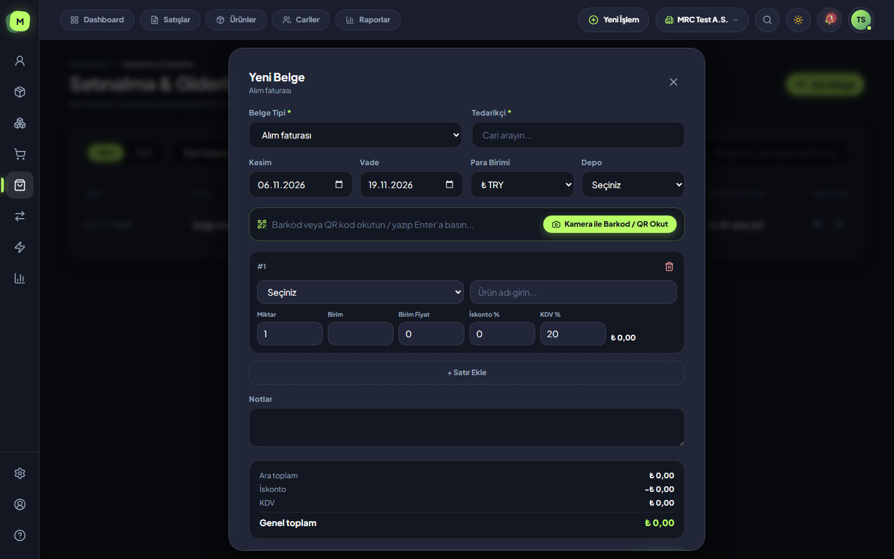

# Süreç: Alım → Stok Girişi → Maliyetin Güncellenmesi → Ödeme

Malı nereden aldığını belgelediğinde sistem **stoğu kendiliğinden artırır** ve **ürünün maliyetini
yeniden hesaplar**. Bu yüzden kârın doğru çıkar. Alım faturası için **elle stok girişi yapmana
gerek yoktur** (çift kayıt olur).

## 1. Tedarikçiyi hazırla

[Cariler](Cariler) → **Yeni Cari** → tip **Tedarikçi** (veya **Her İkisi**) → **Kaydet**.

## 2. Ürün ve depoyu hazırla

- [Ürünler](Urunler): ürün kartında **Stok takibi açık** olmalı (hizmetse kapat).
- [Stok](Stok) → **Depolar**: malın gireceği depo; birini **Varsayılan depo** işaretle.

## 3. Alım faturasını kes



1. [Alımlar](Alimlar) → **Yeni Belge**.
2. **Tedarikçi \***: adı yaz, açılan listeden **seç**.
3. **Depo**: malın gireceği depo (seçmezsen varsayılan depo kullanılır).
4. Satırlar: ürün seç → **Miktar** ve **Birim Fiyat** = **ödediğin alım fiyatı**.
   (Hizmet/gider için serbest satır: „Nakliye", „Kira" — stok etkisi olmaz.)
5. İndirim/KDV gir → alt toplamları kontrol et → **Kaydet** (`ALM-26-00001`, durum **Taslak**).

## 4. İhraç et — stok ve maliyet burada hareket eder

Alım belgesinin detayında **İhraç et**. Sistem otomatik:

1. Seçili depoya **stok girişi** yazar (ürün adedi artar).
2. Ürünün **ağırlıklı ortalama maliyetini** günceller:

   ```
   yeni maliyet = (eski stok × eski maliyet + gelen miktar × alım birim fiyatı) ÷ (eski stok + gelen miktar)
   ```

   **Örnek:** depoda 10 adet, maliyet 40 TL. 5 adet 70 TL'den alındı →
   (10×40 + 5×70) ÷ 15 = **50 TL**. Stok değerindeki mal artık 50 TL üzerinden sayılır.

3. Durum **İhraç** olur; belge artık düzenlenemez/sililemez.

## 5. Tedarikçi ödemesini işle

[Borç-Alacak](Borc-Alacak) → **Ödeme Yap**: cari = tedarikçi, yön = **Ödeme**, tutar ve hesap seç;
istersen **bağlı belge** olarak alım faturasını seç. Belgeye bağlı ödemede fatura durumu
kendiliğinden **Kısmen ödendi / Ödendi** olur. Cari **borcun** (negatif bakiye) kapanır.

## 6. Sonucu gör

- [Stok](Stok): **Güncel stok** ve hareket listesi („Giriş · +5").
- [Ürünler](Urunler): ürünün **Alış** fiyatı yeni ortalama maliyeti gösterir.
- Raporlarda **Stok değeri** = miktar × ortalama maliyet.

---

## Sık karışan noktalar

| Durum | Doğrusu |
| --- | --- |
| „Alım kestim, stok artmadı" | Belge **Taslak**tır. **İhraç et**. |
| „Aynı malı iki yerden aldım, maliyet hangi fiyat?" | Ağırlıklı ortalama. Pahalı alım maliyeti yükseltir, ucuz alım düşürür. |
| „Alım fiyatını yanlış girdim" | Taslaktaysa **Düzenle**. İhraç edildiyse yeni alım faturası ile farkı düzelt (iskonto/eksik-alım satırı). |
| „Elle stok girişi yapsam olur mu?" | Alım belgesi kesilecekse **yapma** — çift kayıt olur. Yalnız sayım farkı/açılış için [Stok](Stok) hareketi kullan. |
| „Hizmet alımı (kira, nakliye) burada mı?" | Evet, serbest satırla. Stok/maliyet etkisi olmaz. |
| „Alım sonrası eski satışların kârı değişti mi?" | Hayır. Satış satırının maliyeti **fatura kesildiği anda donar**. |
| „Ürün aldim ama ortalama maliyet değişmedi" | Ürünün **Stok takibi açık** olmayabilir; ürün kartını kontrol et. |

## Kontrol listesi (alım tamamlandı mı?)

- [ ] Tedarikçi carisi **Tedarikçi/Her İkisi** tipinde
- [ ] Alım faturası kesildi ve **İhraç** edildi
- [ ] Doğru depoya giriş oldu (Stok ekranında „Giriş" satırı var)
- [ ] Ürünün alış fiyatı/ortalama maliyeti güncellendi
- [ ] Ödeme kaydedildi (gerekiyorsa **Kısmen ödendi** durumu kontrol edildi)
