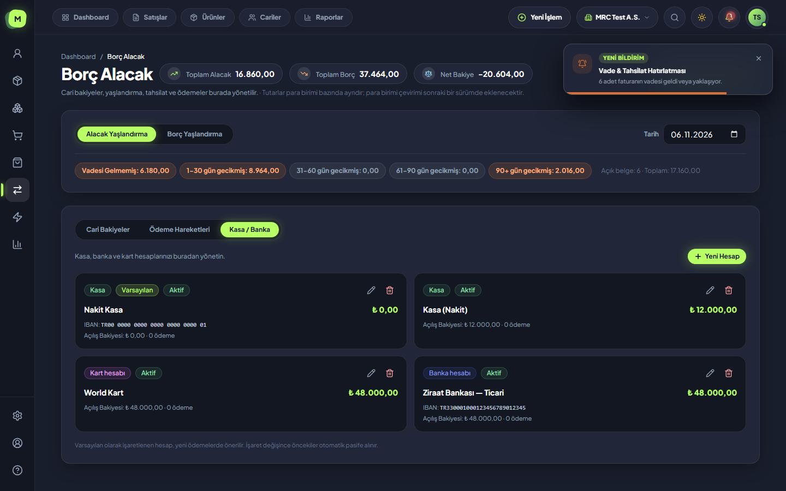

# Süreç: Fatura → Vade Takibi → Tahsilat → Bakiye Kapatma

Paranın izini sürme süreci. Satış/alım tarafı için bkz. [SUREC-TEKLIF-SATIS](SUREC-TEKLIF-SATIS)
ve [SUREC-ALIM-STOK](SUREC-ALIM-STOK).

## 0. Kasanı/bankayı bir kere tanımla

1. [Borç Alacak](Borc-Alacak) → **Kasa / Banka** sekmesi → **Yeni Hesap**.
2. **Hesap Adı \*** (örn. „Nakit Kasa”, „Merkez Banka”), **Tip** (**Kasa / Banka hesabı / Kart
   hesabı**), **Para Birimi**, istersen **IBAN / Hesap no**, ilk gün sayıyorsan **Açılış Bakiyesi**.
3. **Varsayılan** işaretle (yeni ödemelerde otomatik gelir) → **Kaydet**.

> Birden fazla para birimin varsa her biri için ayrı hesap aç: ₺ kasa, $ banka gibi. Sistem
> dövizleri birbirine çevirmez; **aynı para birimindeki** hesap seçmek zorunludur.

## 1. Kime ne kadar borçlu olduğunu öğren

[Borç Alacak](Borc-Alacak) ekranının üst şeridi: **Toplam Alacak**, **Toplam Borç**, **Net Bakiye**.

**Cari Bakiyeler** listesinde satır bul:

- **BAKİYE artı (+)** → müşteri sana borçlu (alacağın).
- **BAKİYE eksi (−)** → sen borçlusun, ya da müşteriden erken para almışsın (avans).

## 2. Vadesi geçen alacakları gör

1. Aynı ekranda **Alacak Yaşlandırma** sekmesini seç.
2. Kovalar: **Vadesi Gelmemiş · 1-30 gün gecikmiş · 31-60 gün gecikmiş · 61-90 gün gecikmiş ·
   90+ gün gecikmiş**.
3. Üstteki **Tarih** alanını değiştirerek „şu tarihte ne durumdaydı?" sorusunu cevaplayabilirsin.
4. Borç tarafı için **Borç Yaşlandırma** sekmesine geç.

> Bu kovalar **vade tarihine** göre hesaplanır. Faturada **Vade** boşsa tutar „Vadesi Gelmemiş"
> kovasına düşer — yani vade girmeyi unutursan gecikmeyi göremezsin.

## 3. Tahsilatı işle

1. Cari satırına tıkla → **Cari Bakiye Detayı** açılır.
2. **AÇIK BELGELER** listesinden tahsil edeceğin faturayı not et (seri, **kalan** tutar).
3. **Tahsilat Al** butonuna bas.
4. **Yön: Tahsilat**, **Tutar**, **Para Birimi**, **Tarih**, **Yöntem** (Nakit/Banka/Kart/Havale-EFT),
   **Kasa / Banka** seç.
5. Belge karşılığında tahsil ediyorsan **Bağlı belge** listesinden seç
   (yalnız **İhraç / Kısmen ödendi** belgeler listelenir). Para birimi otomatik kilitlenir.
6. **Kaydet** → „Ödeme kaydedildi. Güncel bakiye: …" mesajını gör.

Sonuçlar otomatiktir:

| Tahsilat | Belgenin durumu | Carinin bakiyesi |
| --- | --- | --- |
| Belgenin tamamı | **Ödendi** | belge kadar düşer |
| Belgenin bir kısmı | **Kısmen ödendi** | kısmi kadar düşer |
| Belgeye bağlanmadı | belge **İhraç** kalır | yine de düşer (avans/açık hesap) |

## 4. Tedarikçi ödemesini işle

**Yeni Ödeme Kaydet** → **Yön: Ödeme** → tedarikçi carisi → tutar/hesap → alım faturasını
**Bağlı belge** olarak seç → **Kaydet**. Alım faturası **Kısmen ödendi / Ödendi** olur,
carideki **borcun** kapanır.

## 5. Kısmi tahsilatı ve avansı takip et

- Yarım kalan tahsilatta bakiye **pozitif kalır**; kalan tutar cari detayında **kalan** sütununda
  görünür.
- Fazla tahsilat (avans) engellenmez: bakiye **eksiye** düşer, fatura **Ödendi** olur,
  PDF'te **„Fazla ödeme"** satırı çıkar. Sonraki faturalar bu avanstan otomatik düşmez;
  avansı kullanmak için yeni tahsilat kaydetmene gerek yoktur — bakiye zaten alacaklıdır.

## 6. Yanlış kaydı düzelt

1. **Ödeme Hareketleri** sekmesinde hareketi bul.
2. **Sil** → „Ödeme Silinsin mi?" → **Evet, Sil**.
3. Bağlı belgenin durumu geri alınır (örn. **Ödendi → İhraç**), bakiye ve yaşlandırma tazelenir.
4. Doğrusunu yeniden kaydet.

## 7. Sonucu raporla gör

- Panel: **Tahsil Edilecek Alacak** ve **Vade** bilgisi.
- [Raporlar](Raporlar) → **Cari Bakiye** sekmesi: yaşlandırma bloğu + cari bakiye listesi;
  sayılar bu ekranla aynıdır. Orada cari satırını açıp **Tahsilat Al** diyebilirsin.

---

## Sık karışan noktalar

| Durum | Doğrusu |
| --- | --- |
| „Tahsilat yaptım, fatura hâlâ İhraç görünüyor" | Tahsilat **bağlı belge** seçilmeden kaydedilmiş. Ödemeyi sil, belgeye bağlı kaydet. |
| „Bakiye eksi çıkmış, yanlış mı?" | Değil. Eksi bakiye avans/borcumuz demektir; müşteri fazladan ödediyse böyle görünür. |
| „Vadesi geçen alacağım 0 görünüyor" | Faturalarda **Vade** boş. Belgeyi sil (taslaktaysa) veya yeni belgede vade gir. |
| „Döviz tahsilatı TL kasaya işleyemiyorum" | v1'de kur çevirimi yok: **aynı para biriminde** hesap aç ve onu seç. |
| „Kasayı silmek istiyorum, izin vermiyor" | Hareket görmüş hesap silinmez; **Aktif** işaretini kaldır (pasife al). |
| „Müşteri kartını silmek istiyorum, izin vermiyor" | Belgesi/ödemesi olan cari silinmez (geçmiş kaybolmasın). |
| „Ödemeyi sildim, fatura Ödendi kaldı" | Ekranı yenile; sunucu durumu yeniden hesaplar. |

## Kontrol listesi (borç-alacak günü kapandı mı?)

- [ ] Nakit kasaya giren çıkan, **Nakit** yöntemiyle kaydedildi
- [ ] Bankadan gelen/havale, ilgili **banka hesabına** bağlandı
- [ ] Tahsil edilen faturalar **Bağlı belge** ile işaretlendi
- [ ] **Alacak Yaşlandırma** kovalarında beklenmeyen gecikme yok (varsa müşteriyle görüşüldü)
- [ ] Tedarikçi ödemeleri kaydedildi, **Borç Yaşlandırma** kontrol edildi
- [ ] Gün sonu **Net Bakiye** not edildi
