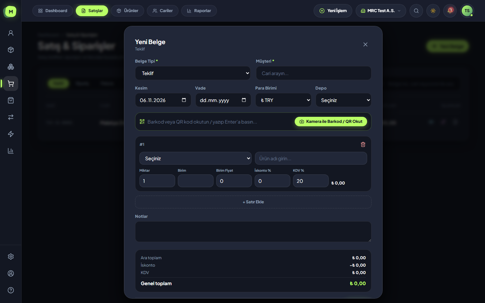

# Süreç: Teklif → Sipariş → Fatura → Tahsilat

Bir satışın baştan sona işleyişi. Adımları bu sırayla yap; her adım bir sonrakini hazırlar.

> Kısayol: küçük işlerde doğrudan **Fatura** da kesebilirsin (Teklif/Sipariş zorunlu değildir).

## 1. Müşteriyi hazırla

[Cariler](Cariler) ekranında **Yeni Cari** → tip **Müşteri** (veya **Her İkisi**) → **Kaydet**.
Cari kodu otomatik verilir (`00001`).

## 2. Ürünü hazırla

[Ürünler](Urunler): gerekirse **Tanımlar** sekmesinde kategori/birim, sonra **Yeni Ürün**
(alış fiyatı, satış fiyatı, KDV, min. stok, **Stok takibi açık**).

## 3. Teklif kes

1. [Satışlar](Satislar) → **Yeni Belge**.
2. **Belge Tipi: Teklif**.
3. **Müşteri \***: adı yaz, açılan listeden **seç**.
4. **Vade**: teklifin geçerlilik tarihi (opsiyonel). Teklif vadesiz de açılabilir;
   **fatura ve alım faturasında** Vade alanı otomatik olarak **kesim + firmanın varsayılan
   vadesi** (Ayarlar → Varsayılan Vade) ile dolar; elle değiştirebilirsin.
5. Satırlar: **ürün seç** ya da serbest kalem yaz; **Miktar / Birim Fiyat / İskonto % / KDV %**.
6. Alt toplamları kontrol et → **Kaydet**.
7. Numara: `TEK-26-00001`.

Teklif stoğu **düşürmez**. Müşteri onay vermezse belgeyi **İptal et** ile kapat.

## 4. Teklifi siparişe çevir

1. Teklifin satırında **Görüntüle** → **Belge Detayı**.
2. İstersen durumu ilerlet: **Gönderildi yap** (müşteriye ilettin) → müşteri onaylayınca
   **Kabul et**, onay vermeyince **Reddet**. Bu adımlar zorunlu değildir; akışı
   doğrudan dönüştürme ile de sürdürebilirsin.
3. **Siparişe dönüştür**.
4. Yeni belge `SIP-26-00002` olarak açılır; teklif kayıt olarak kalır.

## 5. Siparişi faturaya çevir (veya doğrudan fatura kes)

1. Sipariş detayında istersen **Onayla** ile durumu **Onaylandı** yap (sipariş ihraç edilmez).
2. Sipariş detayında **Faturaya dönüştür** → `FTR-26-00003`.
3. Ya da [Satışlar](Satislar) → **Yeni Belge** → tip **Fatura**.

Fatura da henüz **Taslak**tır; stok hâlâ düşmez.

## 6. Faturayı ihraç et (malın/mal hizmetin çıktığı an)

1. Fatura detayında **İhraç et**.
2. Bu anda sistem şunları otomatik yapar:
   - Stok takibi olan her ürün satırı için **stok düşer** (Seçili depo; seçmediysen **Ana Depo**).
   - Satıra **maliyet** o anki ortalama maliyet olarak **yazılır ve bir daha değişmez** → kâr hesabı.
   - Durum **İhraç** olur; belge artık düzenlenemez/sililemez.
3. **PDF indir** → `FTR-26-00003.pdf` (mühür/irsaliye yerine müşteriye gönderilir).

## 7. Tahsilatı işle

[Borç-Alacak](Borc-Alacak) ekranından **Tahsilat Al**:

- Cari seç, **tutar** ve tarihi gir, istersen kasayı/bankayı ve **bağlı belgeyi** seç.
- Tahsilat belgeye bağlanınca faturanın durumu kendiliğinden değişir:
  eksik kaldıysa **Kısmen ödendi**, tamamı tahsil edildiyse **Ödendi**.
- Belgeye bağlamadan da kaydedebilirsin (açık hesap tahsilatı); carinin bakiyesi düşer.

## 8. Sonucu raporla gör

- [Satışlar](Satislar) üstündeki haplar: **Toplam satış**, **Kâr**, **KDV**.
- [Raporlar](Raporlar) ekranında ciro/KDV/yaşlandırma dökümleri: **Satış Özeti**, **KDV Özeti**,
  **Cari Bakiye** ve **Stok Değeri** sekmeleri; **CSV indir** ve **Yazdır** üstte.

---

## Sık karışan noktalar

| Durum | Doğrusu |
| --- | --- |
| „Teklif kestim, stok düştü mü?" | Hayır. Stok yalnız **fatura ihraç** edilince düşer. |
| „Yanlış fatura kestim" | İhraç edilmediyse **Sil**. İhraç edildiyse yeni belge ile düzelt; eski belge kalır. |
| „Teklif doğrudan fatura olsun" | Olmaz: **Teklif → Sipariş → Fatura** (sistem „önce siparişe dönüştürün" der). |
| „Ödeme geldi ama fatura hâlâ İhraç" | Tahsilatı **belgeye bağla**; durum otomatik **Ödendi/Kısmen ödendi** olur. |
| „Kâr düşük görünüyor" | Ürünün **alım faturası** kesilmemiş olabilir; maliyet, alım ihraç edildikçe güncellenir. |
| „Stok eksi görünüyor" | Satış engellenmez; [Stok](Stok) ekranında **Düzeltme** ile gerçek sayıya çek. |

## Kontrol listesi (satış tamamlandı mı?)

- [ ] Teklif onaylandı ve siparişe dönüştürüldü
- [ ] Fatura kesildi ve **İhraç** edildi
- [ ] Faturanın PDF'i alındı/gönderildi
- [ ] Tahsilat kaydedildi (gerekiyorsa **Kısmen ödendi** durumu kontrol edildi)
- [ ] Cari bakiyesi beklenen değerde
