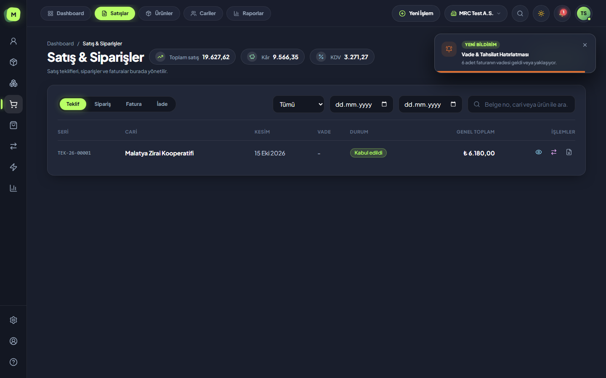

# Satışlar

## Bu ekran ne işe yarar?

Sana ne sattığını buradan belgelersin: **teklif** → **sipariş** → **fatura**. Teklif ve sipariş
stoğu düşürmez; stok **fatura „İhraç” edildiğinde** düşer. Ekran, belgelerini listeler, yeni
belge oluşturmanı, taslakları düzenlemeni/silmeni, ihraç/iptal etmeni ve PDF almanı sağlar.

Üstte üç sayı hapsı senin firmanın **bu yılı** özetler: **Toplam satış**, **Kâr**, **KDV**.

## Adım adım

### 1) Belgeleri listeleme

1. Sol menüden **Satış** seçeneğine tıkla (üst menüde **Satışlar**).
2. Üstteki sekmelerle tipi seç: **Teklif** · **Sipariş** · **Fatura** · **İade**.
3. Yanında durum filtresi (**Taslak** / **İhraç** / **İptal**), arama kutusu
   („Belge no, cari veya ürün ile ara...") ve iki tarih alanı vardır.
4. Tablo kolonları: **SERİ · CARİ · KESİM · VADE · DURUM · GENEL TOPLAM · İŞLEMLER**.
5. Liste altında „Toplam :n kayıt · Sayfa :x / :y" ve **Önceki / Sonraki** bulunur.

### 2) Yeni belge oluşturma

1. Sağ üstteki **Yeni Belge** butonuna bas (liste boşken ortadaki **Yeni Belge Ekle** de aynı işi görür).
2. **Belge Tipi \*** kutusunu seç: **Teklif**, **Sipariş**, **Fatura** veya **İade**
   (iade elle de kesilir; faturadan tek tuşla açmak için §9'a bak).
3. **Müşteri \*** alanına müşterinin adını yaz → açılan listeden kişiyi **tıklayarak** seç.
4. İstersen **Kesim** ve **Vade** tarihlerini değiştir; **Para Birimi** (₺ TRY / $ USD / € EUR) ve
   **Depo** seçebilirsin.
5. Satırı kur: açılır listeden **ürün seç** (seçince ad, birim, fiyat ve KDV otomatik gelir) ya da
   **Ürün adı girin...** alanına serbest bir kalem yaz.
6. **Miktar**, **Birim Fiyat**, **İskonto %**, **KDV %** alanlarını doldur.
7. Alt satırda canlı toplam görünür: **Ara toplam · İskonto · KDV · Genel toplam**.
8. Birden fazla kalem için **+ Satır Ekle**; yanlış satırı satırın sağındaki **Satır sil** ile çıkar.
9. İstersen **Notlar** alanına açıklama yaz.
10. **Kaydet**. Belge numaralanır (örn. `TEK-26-00001`, `SIP-26-00002`, `FTR-26-00003`) ve detay
    penceresi açılır.

### 3) Fatura veya alım faturasını ihraç etme (kesme)

1. Satırdaki **Görüntüle** simgesine tıkla → sağdan **Belge Detayı** açılır.
2. **İhraç et** butonuna bas. Durum **İhraç** olur. Bu buton yalnız **Taslak** durumdaki
   **fatura** ve **alım faturası**nda görünür; teklif/sipariş ihraç edilmez (bkz. 4).
3. Faturaysa bu anda: stok düşer, her ürün satırının **maliyeti o anki ortalama maliyet olarak
   kayda geçer** (kâr hesabının temeli budur).

### 4) Teklif ve siparişin durumunu ilerletme

Belgenin bir sonraki adımı buton olarak önerilir; yanlış fiil gösterilmez:

| Belge | Şu an | Gördüğün buton | Butona basınca |
| --- | --- | --- | --- |
| Teklif | **Taslak** | **Gönderildi yap** | Durum **Gönderildi** olur (müşteriye ilettiğini işaretlersin) |
| Teklif | **Gönderildi** | **Kabul et** / **Reddet** / **İptal et** | **Kabul edildi** ya da **Reddedildi** |
| Sipariş | **Taslak** | **Onayla** | Durum **Onaylandı** olur |
| Fatura / Alım | **Taslak** | **İhraç et** | Kesinleşir; stok ve rapor etkisi başlar |

- **Gönderilen teklif iptal edilebilir**; kabul/red sonrası durum kilitlenir.
- Filtre kutusunda artık **Gönderildi · Kabul edildi · Reddedildi · Onaylandı** seçenekleri de
  vardır; bu belgeleri **Tümü** dışında bulmak kolaydır.
- Bir teklifi **reddettiysen** tekrar kabul edemezsin; yeni teklif kes.

### 5) Teklifi siparişe, siparişi faturaya çevirme

1. Belgenin detayını aç.
2. **Siparişe dönüştür** / **Faturaya dönüştür** butonuna bas.
3. Yeni belge **yeni numarayla** oluşur, **Taslak** doğar ve **Kesim** tarihi bugündür;
   cari, vade, para birimi ve satırlar kaynak belgeden aynen taşınır.
4. Eski belge kayıt olarak kalır ve „dönüştürüldü" ilişkisi korunur.

### 6) Taslak belgede düzenleme ve silme

- **Düzenle** ve **Sil** butonları yalnız **Taslak** satırlarında görünür.
- Silmede onay penceresi açılır: „**FTR-26-00001** kalıcı olarak silinecektir." → **Evet, Sil**.

### 7) PDF alma

- Satırda veya detay penceresinde **PDF indir** → `FTR-26-00001.pdf` iner.
- Taslak belgenin PDF'inde soluk „TASLAK" yazar; ihraç edilmiş belgede yazmaz.
- PDF’in üst künyesinde **firma logon**, firma adı, adres, **Vergi dairesi** ve **Vergi no**
  durur. Logo ve vergi bilgileri [Ayarlar](Ayarlar) ekranından doldurulur; boş olan alan
  PDF’te satır olarak hiç görünmez.
- Belge **ödendiyse** künyede tahsil edilen/kalan tutarlar da yazar; fazla tahsilatta
  „Fazla ödeme" satırı görünür.

### 8) İhraç edilmiş faturaya ödeme bağlantısı gönderme (kartla tahsilat)

- Faturanın detay penceresini aç: en altta **Ödeme Bağlantıları** bölümü görünür
  (yalnız **ihraç edilmiş** satış faturasında; teklif/sipariş/taslakta bu bölüm yoktur —
  müşteri daha neye ödeyeceğini bilmiyor demektir).
- **Yeni Bağlantı** → **Sağlayıcı** seç (PayTR veya iyzico — hangisini seçeceğin
  [Ayarlar](Ayarlar) → **Ödeme Ayarları** kartında hangisini tanımladığına bağlıdır),
  **Tutar** (varsayılan = faturanın genel toplamı; kısmi tahsilat sonrası kalanını yazabilirsin,
  kalanı aşamazsın), **Geçerlilik** (gün; varsayılan 7).
- **Bağlantı Üret** → ödeme adresi belirir; **Kopyala** ile alıp müşteriye gönder
  (WhatsApp/e-posta). Müşteri kartıyla öder; para gelince tahsilat **kendiliğinden**
  deftere işlenir ve fatura durumu güncellenir (bu ekranda „ödendi" işaretleme yoktur —
  para gerçekten gelmeden kayıt doğmaz).
- Bağlantı henüz ödenmediyse **Süresini doldur** ile kapatabilirsin. Ödenmiş bağlantı
  kapatılamaz. Ayrıntı: [ONLINE-ODEME](ONLINE-ODEME).

### 9) İade alma (müşteri malı geri getirdi)

1. Kesilmiş faturanın detayını aç → **İade al** butonu (yalnız kesilmiş belgede görünür).
2. İade belgesi satırlarla birlikte doğar (**Taslak**, `IAD-…` seri): miktarları
   budayabilirsin (kaynak satırı aşamazsın).
3. **İhraç et** → mal rafa girer, belge **İhraç** olur.
4. Para iadesi gerekiyorsa [Borc-Alacak](Borc-Alacak) ekranından iade belgesine
   bağlı **ödeme** kaydet (yön: müşteriye giden). Belge tutarı kapanınca durum
   **Ödendi** olur.
5. Kısmi iade mümkündür (1 kalem / 1 adet); kalan için aynı faturadan yeniden
   iade açılabilir. Fazlası reddedilir („İade miktarı kaynağı aşamaz.").
6. Kaynaksız iade de kesilir: **Yeni Belge** → tip **İade**, cari + satırları elle doldur
   (kaynak fatura bağlanmazsa miktar denetimi yapılmaz).

> İadenin kâr etkisi: Raporlar'da iade, cirodan da maliyetten de düşer (kâr gerçeği verir).
> Alım tarafında tedarikçiye iade [Alimlar](Alimlar) ekranında aynı düğmeyle yapılır.

### 10) Belge silme (her durumda)

1. Detayda **Sil** her belgede görünür (taslak, kesilmiş, iptal — fark etmez).
2. Kesilmiş belgede silme şunları tek işlemde yapar: stok aynaya düşer
   (`cancel:<id>` izli), bağlı iade(ler) aynıyla silinir, ödeme(ler) denetim
   kaydına yazılarak düşer, dönüştürme bağları kopar (türetilmiş belge durur).
3. Ayrı yol istersen: önce **İptal et** (kayıt + stok tersi durur), sonra **Sil**.
   İptal edilmiş belgeyi silmek de serbesttir. Ödemeli belge iptal EDİLEMEZ
   („Ödemesi olan belge iptal edilemez...") — ama doğrudan SİLİNEBİLİR.

### 11) İrsaliye yazdırma ve çıktı dili

1. Kesilmiş faturanın detayında **Çıktı dili** seç (TR/EN) → **PDF indir** o dilde iner
   (etiketler, tutarlar, tarih biçimi ve ürün adları dahil).
2. **İrsaliye** düğmesi fiyatsız sevkiyat listesi basar (sıra no + ürün + miktar + birim):
   depodan mal çıkarken şoföre/ne teslim tutanağı olarak verilir. Muhasebe etkisi yoktur.
3. Ürün adının İngilizcesi ürün kartında yazılır (**Ürün Adı (İngilizce)** alanı);
   boşsa İngilizce çıktıda Türkçe ad görünür.
4. Hızlı satış fişi de aynı dil seçimiyle basılır (POS ekranında **Çıktı dili**).

## Alan açıklamaları

| Alan | Zorunlu | Boş bırakılırsa | Not |
| --- | --- | --- | --- |
| Belge Tipi | Evet | — | Teklif/sipariş stoğu etkilemez; fatura ihraçta stoğu düşürür; iade ihraçta stoğu artırır |
| Müşteri | Evet | Kaydedilmez | Cari tipinde **Müşteri** veya **Her İkisi** olmalı |
| Kesim | Hayır | bugün | Belge numarası yıla göre verilir |
| Vade | Hayır | kesim + firmanın varsayılan vadesi | Vadeyi elle değiştirebilirsin; vadesiz bırakmak istiyorsan **Ayarlar → Varsayılan Vade** alanını 0 yap. Yaşlandırma raporu vadeye göre çalışır |
| Para Birimi | Hayır | firmanın para birimi | Ödeme bu para birimiyle kaydedilebilir |
| Depo | Hayır | **Ana Depo** (varsayılan depo) | Fiyat/ürün listesi tüm depoları görür |
| Ürün adı | Ürün seçilmediyse Evet | — | Ürün seçiliyse ad otomatik gelir |
| Miktar | Evet | 0 olamaz | Ondalık girilebilir (kg vb.) |
| Birim Fiyat | Evet | 0 kabul edilir | Ürün kartındaki satış fiyatı öneri olarak gelir |
| İskonto % | Hayır | 0 | Satır tutarı üzerinden **yüzde** (%10 = 10) |
| KDV % | Hayır | ürünün KDV oranı; ürün seçilmediyse firmanın varsayılan KDV'si | Satır bazında değiştirilebilir |
| Notlar | Hayır | boş | PDF'te „Notlar" kutusunda görünür |

## Takıldığınızda

- **„Belge bulunamadı" / „Filtrelere uygun belge yok."** → Sekme veya filtre boş sonuç veriyor:
  **Tümü** dışı bir durum seçiliyse değiştir, tarih alanlarını temizle, arama kutusunu boşalt.
- **„Cari hesap alanı zorunludur."** → Müşteri alanına yazıp açılan listeden **seçmedin**; yalnız
  yazmak yeterli değildir.
- **„Bu cari hesap tipi için bu yönde ödeme kaydedilemez."** → Cari **Tedarikçi** olarak tanımlı;
  satış için tipini **Her İkisi** yap.
- **„Satır adı zorunludur."** → Serbest satırın adı boş.
- **„Satır miktarı 0 olamaz."** → Miktar 0; silmek istiyorsan **Satır sil**.
- **„Bu belge Taslak durumundan Ödendi durumuna geçirilemez."** → Önce **İhraç et**, sonra tahsilat
  kaydet; ödeme geldiğinde durum kendiliğinden **Kısmen ödendi/Ödendi** olur. (Mesajda durumlar
  senin gördüğün adlarla yazar; `draft`, `issued` gibi iç kodlar artık görünmez.)
- **„Bu belge Taslak durumundan İhraç durumuna geçirilemez."** → **Teklif** veya **Sipariş**
  belgesini ihraç etmeye çalıştın. Teklif/sipariş ihraç edilmez: **Gönderildi yap / Kabul et /
  Onayla** ve sonra **Siparişe dönüştür / Faturaya dönüştür** ile ilerle. Bu butonlar artık
  yalnız fatura ve alım faturasında görünüyor; bu mesajı görürsen ekranın eski bir sürümü
  açık kalmış olabilir — sayfayı yenile.
- **„Teklif doğrudan faturaya dönüştürülemez; önce siparişe dönüştürün."** → İki adımla ilerle.
- **„Yalnızca taslak belgeler düzenlenebilir." / „…silinebilir."** → Belge ihraç edilmiş. Yeni belge
  keserek düzelt.
- **„PDF indirilemedi."** → Bağlantı sorunu olabilir; sayfayı yenileyip tekrar dene.
- Toplam, senin gördüğün önizlemeden farklıysa → **sunucu değeri esastır**; kayıt sonrası ekran
  sunucudaki toplamlarla tazelenir.

## Bilmenizde yarar var

- Numaralar otomatiktir ve firmanın içinde benzersizdir: `TEK-26-00001`, `SIP-26-00002`,
  `FTR-26-00003`. Elle yazılmaz, değişmez.
- **Kâr hapsı** = net satış − (ürün satırlarının **birim maliyeti × miktarı**). Ürün bağlantısı
  olmayan serbest satırların maliyeti olmaz; bu yüzden cevapta „maliyeti eksik satır" sayacı tutulur.
- Belge **İptal** edilse bile numarası yeniden kullanılmaz.
- Fiyat, indirim ve KDV **satır bazındadır**; ürün kartındaki oran yalnız başlangıç değeridir.
- Tahsilat, **Borç-Alacak** ekranından kaydedilir; belge detayında tahsil edilen/kalan tutarlar
  PDF'te de görünür.
- Vadesi geçmiş faturalar **kırmızı** görünür; yaşlandırma raporu vade tarihine göre çalışır.
