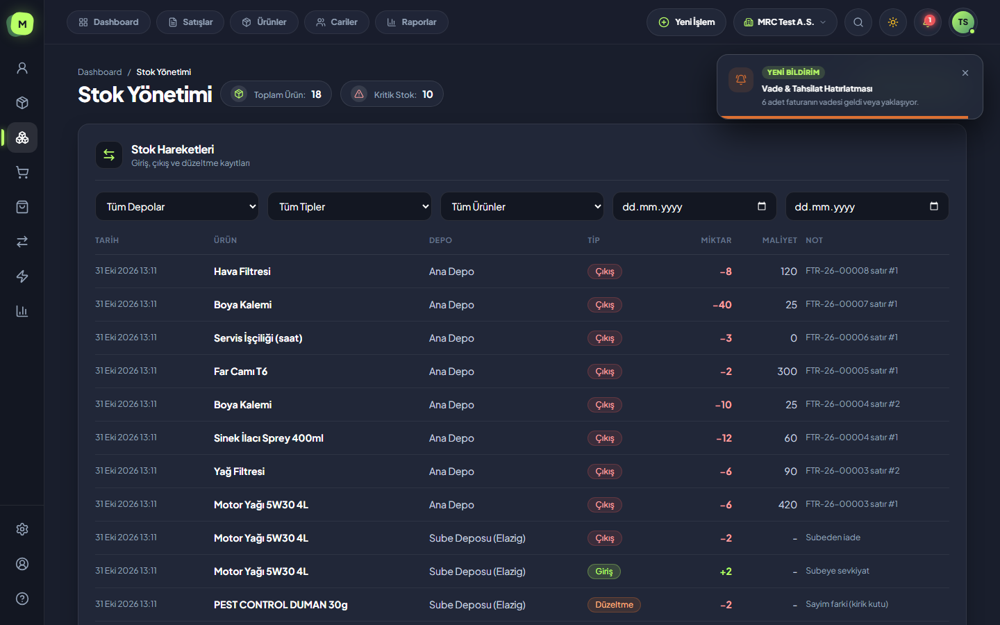

# Stok Yönetimi

## Bu ekran ne işe yarar?

Depolarındaki malın **gireni, çıkanı, sayım farkını** burada tutarsın. Stoğun kendisi bu
kayıtların toplamıdır; sayıyı elle yazmazsın. Ayrıca depoların tanımı buradan yapılır.

Ekranın üstünde iki sayı hapı vardır: **Toplam Ürün** ve **Kritik Stok**.

## Adım adım

### 1) Depo ekleme

1. **Stok** menüsüne tıkla, sayfayı aşağı kaydır → **Depolar** kutusu („Stokların tutulduğu fiziksel depolar").
2. **Depo adı \*** alanına ad yaz (örn. „Ana Depo").
3. İstersen **Adres** gir.
4. Birden fazla depon varsa birini **Varsayılan depo** olarak işaretle; yeni hareketlerde o depo seçili gelir.
5. **Ekle**. Yanında **Varsayılan** rozeti görünür.
6. Satırın sağındaki kalem simgesi → **Depoyu Düzenle** (buton **Güncelle** olur), çöp simgesi → **Depo Silinsin mi?** onayı.

### 2) Mal girişi yapma (Giriş)

1. Sağ üstteki **Manuel Hareket** butonuna bas („Depoya giriş, çıkış veya düzeltme kaydedin").
2. **Ürün** seç (listedeki ad ve stok kodu görünür).
3. **Depo** seç.
4. **Hareket Tipi: Giriş**.
5. **Miktar** ve istersen **Birim Maliyet** gir; **Not** olarak „Açılış girişi", „Sayım farkı" yazabilirsin.
6. **Kaydet**. Üstte „Hareket kaydedildi. Güncel stok: …" mesajı çıkar ve liste yenilenir.

### 3) Mal çıkışı yapma (Çıkış)

Aynı pencere, **Hareket Tipi: Çıkış**. Satırda miktar **−** işaretiyle görünür.

### 4) Sayım farkı / kırık ürün (Düzeltme)

1. **Hareket Tipi: Düzeltme** seç.
2. Miktarı **gerçeğe göre** yaz; **eksi** de olabilir (kırık, fire, kayıp).
3. **Kaydet**.

> Giriş ve çıkış miktarı 0'dan büyük olmalıdır. Düzeltme sıfırdan farklı olmalıdır (negatif olabilir —
> örneğin kırık ürün için −1).

### 5) Hareketleri filtreleme

Liste başındaki üç açılır liste ve iki tarih alanı:
- **Tüm Depolar** → tek depo
- **Tüm Tipler** → **Giriş / Çıkış / Düzeltme**
- **Tüm Ürünler** → tek ürün
- tarih alanları → o aralıktaki hareketler

Liste altında „Toplam :n kayıt · Sayfa :x / :y" satırı ve **Önceki / Sonraki** butonları vardır.

### 6) Depolar arası transfer

1. Sayfa başındaki **Transfer** butonuna bas („Kaynakta yeterli stok olmalı; toplam değişmez.").
2. **Ürün**, **Kaynak Depo**, **Hedef Depo** ve **Miktar** gir (istersen **Not**).
3. **Transferi Bitir** → kaynakta çıkış, hedefte giriş hareketi aynı anda yazılır
   (ikisi de `transfer:#id` izini taşır). Toplam stok değişmez.
4. Kurallar: kaynakta miktar yetersizse transfer **reddedilir**; kaynak ve hedef
   aynı olamaz.

### 7) Stok sayımı

1. Sayfanın altındaki **Stok Sayımları** kutusunda **Yeni Sayım** → **Depo** seç.
2. Satırları **Ürün ara / barkod** kutusundan ekle (kamera düğmesiyle okutabilirsin)
   ya da listeden seç; her satıra **sayılan** adedi yaz.
3. **Sayımı Başlat** → taslak oluşur; her satırda beklenen (sistem) ve sayılan görünür,
   farkı **Detay** açar.
4. **Onayla** → farklar düzeltme hareketi olur (eksi fark stoğu düşürür, artı fark
   yükseltir). Onay yalnız **Admin** yapar; Personel düğmeye basarsa
   „Bu işlem için yönetici yetkisi gereklidir." çıkar.
5. Yanlış taslak **İptal et** ile düşer (taslakken; açan ya da Admin).

## Alan açıklamaları

| Alan | Zorunlu | Boş bırakılırsa | Not |
| --- | --- | --- | --- |
| Ürün | Evet | Hareket açılmaz | Yalnız stok takibi açık ürünler stoğu etkiler |
| Depo | Evet | Hareket açılmaz | Seçmezsen **varsayılan depo** kullanılır |
| Hareket Tipi | Evet | — | Giriş (+), Çıkış (−), Düzeltme (işaretli) |
| Miktar | Evet | Hareket açılmaz | Giriş/çıkışta pozitif; düzeltmede eksi olabilir |
| Birim Maliyet | Hayır | Boş | Girişte malın birim maliyeti; ortalama maliyeti günceller |
| Not | Hayır | boş | Listede „Not" sütununda görünür |
| Depo adı \* | Evet | Depo açılmaz | — |
| Varsayılan depo | Hayır | işaretli değil | İlk depo otomatik varsayılan olur |

## Takıldığınızda

- **„Giriş/çıkış miktarı sıfırdan büyük olmalıdır."** → Miktarı 0 veya eksi girdin. Eksi gereken
  işlem **Düzeltme** tipidir.
- **„Düzeltme miktarı 0 olamaz."** → Düzeltme bir fark içermelidir.
- **„Hareket kaydı bulunamadı"** → Filtreler dar kalmış olabilir: **Tüm Depolar / Tüm Tipler /
  Tüm Ürünler** seç ve tarih alanlarını temizle; ya da **Manuel Hareket Ekle** ile ilk kaydı oluştur.
- **„Stok işlemi için depo gerekli; varsayılan depo bulunamadı."** → Hiç depon yok. **Depolar**
  bölümünden **Yeni Depo** ekle.
- **„Bu depoda stok hareketi mevcut; silinemez. Depoyu pasif hale getirmek için büyük depolara aktarım yapın."**
  → Depoda geçmiş hareket var. Malı diğer depoya aktar (Çıkış + Giriş) ve eski depoyu kullanmayı bırak.
- **Ürün stoğu eksi görünüyor** → Sistem satışı engellemez; stoğu gerçek sayıya çekmek için
  **Düzeltme** yap.

## Bilmenizde yarar var

- **Toplam Ürün** hapsı stok takibi açık/kapalı tüm ürün sayını, **Kritik Stok** hapsı stoğu
  „Min. Stok" eşığının altına düşen ürün sayısını gösterir.
- Depo rozetinde kaç depo yazdığı, filtre seçiminden bağımsız toplam depo sayısıdır.
- Fatura ve alım belgeleri stoğu **kendi kendine** düşürür/artırır; bunları manuel harekete
  yazmana gerek yok (çift kayıt oluşur).
- Bir hareket silinemez; yanlış hareketi **Düzeltme** ile dengeler, gerekirse not olarak açıklarsın.
- Hareket satırındaki **Maliyet** alanı, o hareketin birim maliyetidir; ortalama maliyeti etkiler.
- **Raporlar** sekmesinde üç yeni analiz var: **Tedarik Önerisi** (min altı + öneri miktarı;
  üst sınır ürün kartındaki Maks. Stok, boşsa min×2), **ABC Analizi** (seçili dönem cirosuna
  göre A/B/C), **Devir Hızı** (dönem çıkışı / ortalama stok; son çıkışı eskimiş ürün **Bayat**).
