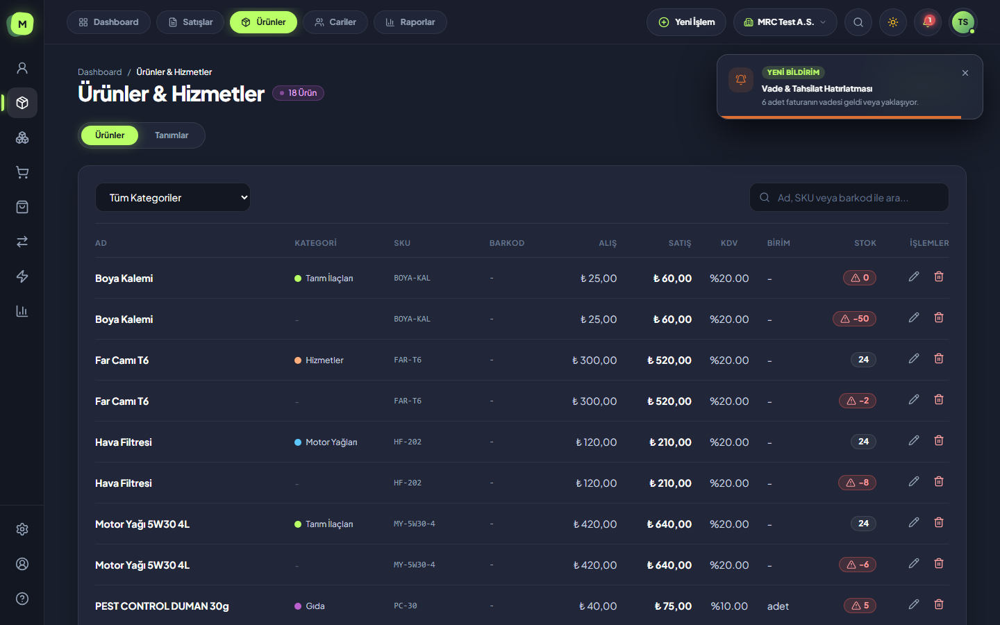

# Ürünler & Hizmetler

## Bu ekran ne işe yarar?

Ne sattığını buradan tanımlarsın: her satış belgesi bir **ürün kartına** bağlanır. Kartta fiyat,
KDV oranı, birim ve stok bilgisi durur. Ayrıca ürünleri grupladığın **kategoriler** ile ölçü
**birimleri** bu ekranda tanımlanır.

Ekranın üstünde iki sekme var: **Ürünler** ve **Tanımlar**.

## Adım adım

### 1) Önce kategori ve birim tanımla (Tanımlar sekmesi)

1. **Tanımlar** sekmesine tıkla.
2. **Kategoriler** kutusunda „Ürün grupları ve renk etiketleri" yazar.
   - **Kategori adı \*** alanına adı yaz (örn. „Gıda").
   - **Renk:** satırından bir renk noktası seç (kategori listesinde ve belgelerde bu renk görünür).
   - **Ekle** butonuna bas. Kategori listeye „0 ürün" sayısıyla düşer.
3. **Birimler** kutusunda „Adet, kg, litre gibi ölçü birimleri" yazar.
   - **Birim adı \* (Adet)** ve **Kod \* (adet)** alanlarını doldur, sonra **Ekle**.
   - Sistemde hazır gelen birim **Adet (adet)** olur ve yanında **Varsayılan** rozeti durur.

### 2) Ürün kartı açma

1. **Ürünler** sekmesine geç.
2. Sağ üstteki **Yeni Ürün** butonuna bas (liste boşsa „Yeni Ürün Ekle" butonu da var).
3. Zorunlu alan: **Ürün Adı \***.
4. **Kategori** ve **Birim** açılır listelerinden seçim yap.
5. **Stok kodu** (kendi ürün kodun) ve istersen **Barkod** gir.
6. **Alış Fiyatı**, **Satış Fiyatı**, **KDV Oranı (%)** ve **Min. Stok** alanlarını doldur.
7. **Stok takibi açık** anahtarı:
   - **Açık** → ürün bir maldır; stoğu sayılır, satışta stok düşer.
   - **Kapalı** → ürün bir hizmettir; stok hiç hesaplanmaz.
8. İstersen **Açıklama** yaz.
9. **Kaydet**. Kart listede görünür; yanındaki rozet toplam ürün sayısını günceller.

### 3) Ürünleri bulma ve düzenleme

- Arama kutusu **ad, SKU veya barkod** üzerinde gezer.
- **Tüm Kategoriler** seçeneğiyle tek kategoriye inebilirsin.
- Satırın sağındaki kalem simgesi → **Ürünü Düzenle**; çöp simgesi → **Ürün Silinsin mi?** onayı.
- Kategorileri ve birimleri de silebilirsin: **Kategoriyi sil** / **Birimi sil** simgeleri
  → **Kategori Silinsin mi?** / **Birim Silinsin mi?** onayı çıkar.

### 4) Barkod üretme ve etiket yazdırma

1. Ürünün kalem simgesine bas → **Ürünü Düzenle** kartı açılır. **Barkod** alanının
   altında barkod paneli durur (kayıtlı üründe görünür).
2. **EAN-13 / CODE128** seç → **Önizle**: barkod resmini görürsün. Boş CODE128 için
   önce **Stok kodu** ya da **Barkod** yazıp **Kaydet** (panel kodu karttan okur).
3. Barkodun yoksa **Otomatik ata** → mağaza-içi EAN-13 üretilir (`24…` ile başlar,
   ürüne özeldir). Dolu ürüne ikinci atama yapılmaz.
4. **PNG** (hızlı paylaşım) / **SVG** (vektör, baskı kalitesi) ile indir.
5. Raf etiketi için **adet** yaz → ölçü seç (38×25 / 40×30 / 50×30) →
   **Fiyatlı** işaretliyse fiyat basılır, işaretsizse fiyatsız etiket çıkar →
   **Etiket yazdır**: seçili ölçüde, adet × ürün sayfası PDF açılır.

> 12 haneli EAN yazarsan 13. hane (kontrol) otomatik eklenir; 13 hanenin kontrolü
> yanlışsa kart „EAN-13 için 12 hane…" diye uyarır. CODE128 her yazdırılabilir
> karakteri aynen kodlar.

## Alan açıklamaları

| Alan | Zorunlu | Boş bırakılırsa | Not |
| --- | --- | --- | --- |
| Ürün Adı | Evet | Kart açılmaz | Belgelerde bu ad görünür |
| Ürün Adı (İngilizce) | Hayır | EN çıktıda Türkçe ad görünür | İngilizce fatura/fiş/irsaliyede basılacak ad; boşsa Türkçe ad kullanılır |
| Kategori | Hayır | Kategorisiz kalır | Listede renk etiketi görünmez |
| Birim | Hayır | Birimsiz kalır | Satışta „adet" gibi görünsün istiyorsan seç |
| Stok kodu / Barkod | Hayır | „-" görünür | Barkod, okutmalı satışta ([HizliSatis](HizliSatis) tarama) ve etikette kullanılır; karttan üretilir |
| Alış Fiyatı | Hayır | 0 | Alım faturası kesildikçe **ağırlıklı ortalama** olarak güncellenir |
| Satış Fiyatı | Hayır | 0 | Belgelerde önerilen fiyat olarak gelir |
| KDV Oranı (%) | Hayır | firmanın varsayılan KDV'si ([Ayarlar](Ayarlar) → Varsayılan KDV Oranı) | Ürün kartındaki oran, belge satırına otomatik kopyalanır |
| Min. Stok | Hayır | 0 | Stok bu değerin altına düşünce **kritik** sayılır |
| Stok takibi açık | — | varsayılan: açık | Hizmet ürünlerinde kapat |
| Açıklama | Hayır | boş | — |

## Takıldığınızda

- **Stok sütununda kırmızı uyarı** → ürün **kritik stokta**: stoğu „Min. Stok" eşiğinin altında.
  Mal girişi yap (**Stok → Manuel Hareket → Giriş**).
- **Yeni ürünün stoğu 0 görünüyor** → normal: ürün kartı stoğu söylemez, stok **hareketlerle** oluşur.
- **„Bu ürüne ait stok hareketi mevcut; silinemez."** → Bu ürün satılmış veya alınmış. Silmek yerine
  kartı düzenleyebilir ya da **Stok takibi açık** anahtarını kapatabilirsin.
- **„Ad zaten kayıtlı."** (kategori eklerken) → Aynı adda bir kategori var; farklı ad ver veya
  mevcut kategoriyi kullan.
- **„Kategori bulunamadı." / „Birim bulunamadı."** → Kayıt az önce silinmiş veya başka firmaya ait.
  Listeyi yenile.
- **Sildiğin kategori/birim bir ürün tarafından kullanılıyorsa** → ürünün kategorisi/birimi boşalır;
  önce ürünleri başka kategoriye al, sonra tanımı sil.

## Bilmenizde yarar var

- Kategori adı **firman içinde** tektir; başka firmanda aynı ad kullanılabilir.
- Liste başındaki violet rozet toplam ürün sayısını gösterir; arama yapınca değişebilir.
- Bir üründe **KDV Oranı**, belgede satır bazında değiştirilebilir (kart yalnız varsayılanı taşır).
- **Alış Fiyatı** elle de değiştirilebilir; alım faturası kesildiğinde sistem kendi hesabıyla günceller.
- Fiyatlar kartta para birimiyle gösterilir (₺ / $ / €); para birimini ürün kartından seçersin.
  Kart açılırken varsayılan olarak **firmanın para birimi** gelir ([Ayarlar](Ayarlar) → Para Birimi).
